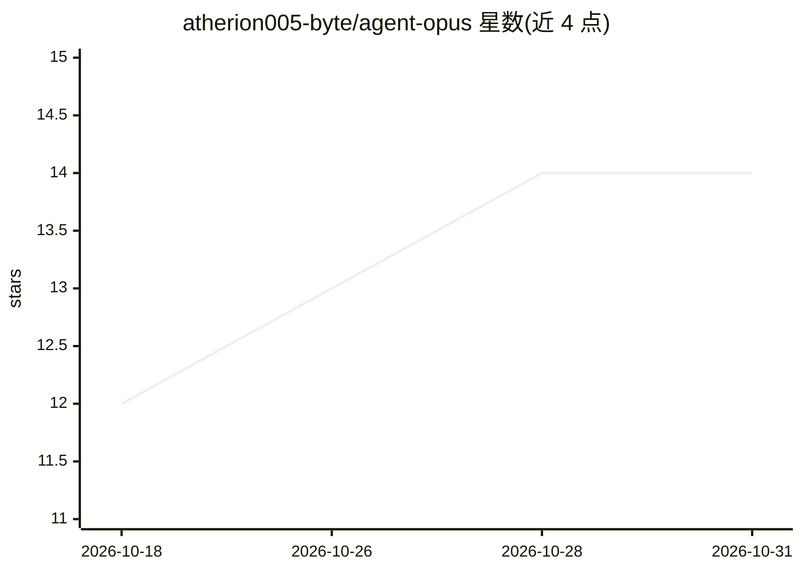

# atherion005-byte/agent-opus

⭐ 14 · Python · MIT · 推送 2026-04-29 · [GitHub](https://github.com/atherion005-byte/agent-opus) · 个人维护

**本地免费开源的 Opus Clip 替代品：自动切短视频配字幕**

本地运行的视频切片工具：下载或读取长视频后，用 Faster-Whisper 做 GPU 转录、YOLOv8 做人物追踪保持居中、逐词黄色高亮字幕烧录进画面，并通过本地 Llama 3（Ollama）或启发式回退打分筛选高传播片段，批量输出最多 10 条 9:16/1:1/16:9 短视频。提供 Gradio 网页界面与 CLI。需 Python 3.10+ 与 CUDA，无 Ollama 时自动回退到本地启发式打分，全程无云端上传、无水印。面向想免费本地制作 Shorts/TikTok 切片的创作者。

## 筛选速览

| 维度 | 判定 | 备注 |
|---|---|---|
| AI 角色 | `ai-native` | 本体是模型或模型工具 |
| 许可风险 | `permissive` | MIT |
| 部署形态 | `library` | 以包/库形式分发 |
| 模型依赖 | local-ok | 支持本地模型 |
| 硬件要求 | `gpu-8g` | |
| 安装摩擦 | `medium` | 含编译或系统依赖之一 |
| 成熟度 | — | 结构信号不足 |

## 能力要点

- Faster-Whisper CUDA 转录 + 逐词高亮字幕烧录
- YOLOv8 人物检测 + scipy 插值实现居中追踪
- Llama 3（Ollama）+ 启发式回退的高传播片段打分
- yt-dlp 支持 YouTube/TikTok/Twitter 下载，最多一次输出 10 条切片

## 适用场景

- 把长视频/直播录像批量切成带动画字幕的短视频
- 本地离线处理视频，避免云端上传
- 为 Shorts/TikTok/Instagram 生成不同宽高比的切片

## 场景标签

`语音识别` `图像视频处理` · 领域:感知与多模态

## 证据(README 行号)

> L26: - **Auto-identify viral moments** — Llama 3 (local) + heuristic fallback
> L29: - **GPU-accelerated transcription** — Faster-Whisper on CUDA
> L65: python clipping_tool/app.py

## 星数曲线

2026-10-18 12 → 2026-10-31 14（+2）

---
*卡片 v1 · prompt 1.4 · 生成 2026-10-31 · 置信度 mid · 依据 README sha `054b2051cb2c` · [字段定义](../../DATASET.md)*
