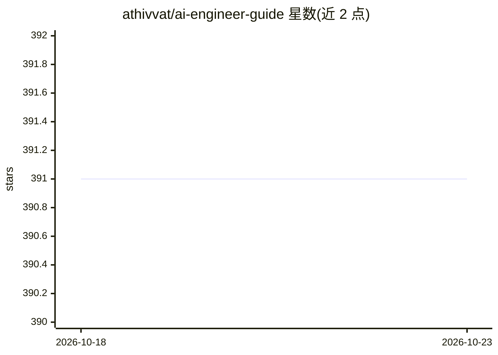

# athivvat/ai-engineer-guide

⭐ 391 · MDX · MIT · 推送 2026-09-17 · [GitHub](https://github.com/athivvat/ai-engineer-guide) · [官网](https://aiengineer.guide) · 个人维护

**AI 工程师成长路线图：从零到 AI 工程师的学习指南**

一份面向软件工程师及跨行转型者的学习路线图资源（2025 第二版），覆盖入门指引、基础知识、核心 AI 技术、进阶 AI 工程（Agentic AI、高级 RAG、多模态、企业级部署）、工具与框架、行业应用、学习资源、职业发展与 AI 伦理等章节。以网站 aiengineer.guide 形式提供内容，仓库接受社区贡献。不包含可运行的代码或模型。

## 筛选速览

| 维度 | 判定 | 备注 |
|---|---|---|
| AI 角色 | `ai-knowledge` | 知识聚合/清单类 |
| 许可风险 | `permissive` | MIT |
| 部署形态 | `None` |  |
| 模型依赖 | — | README 未给出锁定关系 |
| 硬件要求 | — | 无带数字的原话,不猜 |
| 安装摩擦 | `low` | 无编译、无系统依赖或容器化 |
| 成熟度 | — | 结构信号不足 |

## 能力要点

- 按章节组织的学习路线图（目录含入门/基础/核心技术/进阶/企业落地等）
- 第二版纳入 2025 年趋势：Agentic AI、高级 RAG、多模态 AI、企业级部署
- 通过 aiengineer.guide 网站提供内容

## 适用场景

- 软件工程师规划转型 AI 工程师的学习路径
- 跨行业人士了解 AI 工程所需知识体系
- 查找进阶主题（Agentic AI、RAG、多模态）与伦理相关学习材料

## 场景标签

`教程课程` · 领域:学习与行业

## 证据(README 行号)

> L1: # AI Engineer Guide - Edition 2 (2025)
> L3: AI engineer guide is a comprehensive resource for going from software engineer/non-software engineer to professional

## 星数曲线

2026-10-18 391 → 2026-10-23 391（+0）

---
*卡片 v1 · prompt 1.4 · 生成 2026-10-21 · 置信度 high · 依据 README sha `72315731fb67` · [字段定义](../../DATASET.md)*
