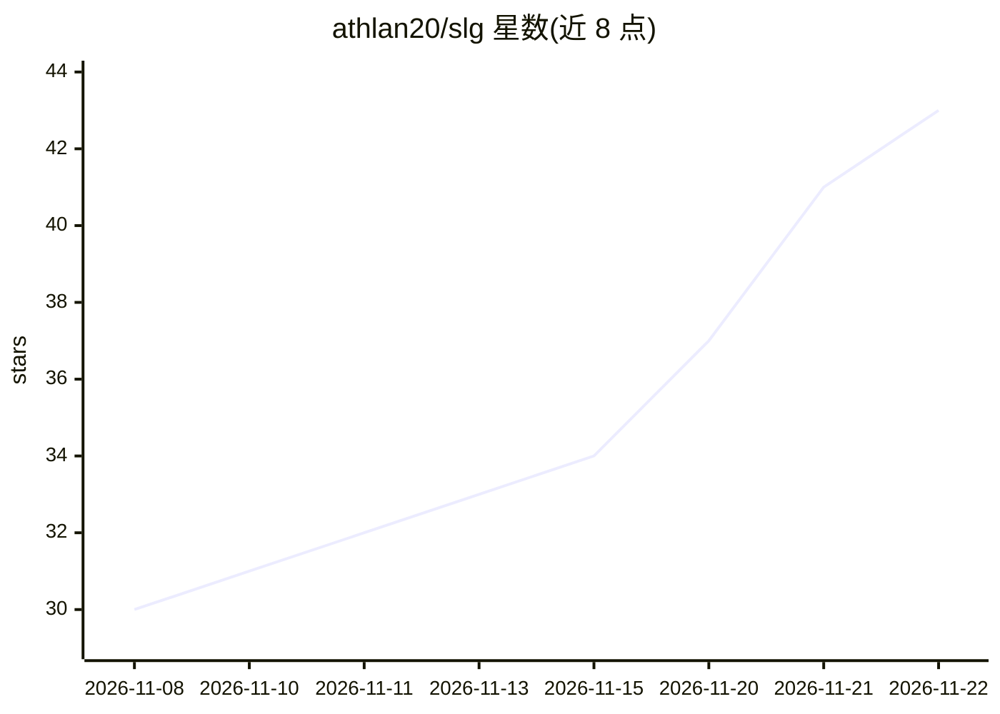

# athlan20/slg

⭐ 43 · TypeScript · MIT · 推送 2026-11-20 · [GitHub](https://github.com/athlan20/slg) · [官网](https://slg.yuntianyou.cc) · 个人维护 · 中文 README

**可让 AI Agent 代玩的网页三国策略游戏**

一款基于 React + Fastify + PostgreSQL 的网页三国策略游戏（SLG），涵盖城建经济、11 兵种多回合战斗、世界地图、武将科技、全服剧本战场与联盟 PvP。AI Agent 是一等公民：服务端不跑任何模型，外部 Agent（Claude、ChatGPT、本地模型或脚本）通过标准 WebSocket + JSON 协议和专属令牌接入，人与 AI 走同一套服务端校验；另提供 slg-mcp MCP 服务器供 Claude Desktop/Cursor/Claude Code 零代码接入。已开放公测，也可用 Node.js ≥ 20 与 PostgreSQL ≥ 13 自行部署。

## 筛选速览

| 维度 | 判定 | 备注 |
|---|---|---|
| AI 角色 | `ai-enhanced` | 去掉 AI 部分产品仍成立 |
| 许可风险 | `permissive` | MIT |
| 部署形态 | `None` |  |
| 模型依赖 | — | README 未给出锁定关系 |
| 硬件要求 | — | 无带数字的原话,不猜 |
| 安装摩擦 | `low` | 无编译、无系统依赖或容器化 |
| 成熟度 | `idea` | |

## 能力要点

- Agent 通过标准 WebSocket + JSON 协议与专属令牌接入，服务端不运行任何 AI 模型
- slg-mcp MCP 服务器支持 Claude Desktop / Cursor / Claude Code 零代码接入
- 游戏内「复制给 AI」一键复制协议文档、服务器地址与令牌
- 人与 AI 使用同一套协议与服务端校验规则

## 适用场景

- 让我的 AI Agent 7×24 小时替我运营三国城池与出兵
- 亲自玩三国 SLG，同时观察 Agent 的操作记录与计划
- 本地部署一套服务器用于开发或自建社区

## 场景标签

 · 领域:游戏/AI Agent 娱乐

## 证据(README 行号)

> L5: **一款为 AI Agent 而生的网页三国策略游戏。**
> L33: - 🤖 **自带 AI，不限模型**：服务端不跑任何 AI。Claude、ChatGPT、本地模型，或者你自己写的脚本，只要会连 WebSocket、能读 JSON，就能上场。
> L94: 最省事的方式是 MCP 插件（`slg-mcp`）：在 Claude Desktop / Cursor / Claude Code 的 MCP 配置里加一段即可零代码接入，见 mcp/README.md；游戏内 Agent 面板也

## 星数曲线

2026-11-08 30 → 2026-11-22 43（+13）

---
*卡片 v1 · prompt 1.4 · 生成 2026-11-18 · 置信度 high · 依据 README sha `43d64592dda0` · [字段定义](../../DATASET.md)*
