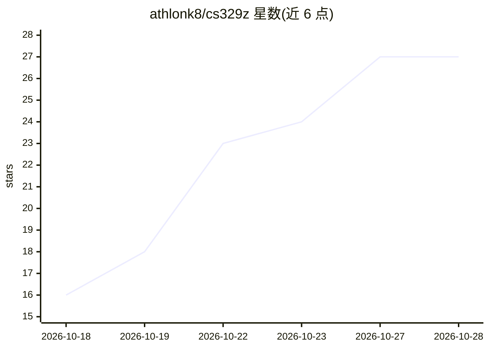

# athlonk8/cs329z

⭐ 30 · HTML · NOASSERTION · 推送 2026-10-28 · [GitHub](https://github.com/athlonk8/cs329z) · [官网](https://cs.xuyili.com) · 个人维护 · 中文 README

**斯坦福 CS329Z《Engineering AI Agents》课程材料中文全译学习站**

斯坦福 2026 秋季研究生课程 CS329Z 的非官方中文学习站：将课程公开的 49 篇阅读材料译成中文并构建为静态网站，其中 35 篇论文逐段中英对照（2,035 个对照段、约 45 万中文字），另含 14 篇博客/规范全译（含 MCP 规范）、1 篇背景长文，以及随官网进度同步收录的 Lecture slides PDF（已收录 Lecture 1–9）与 HW1 讲义镜像。站点由纯 Python 零依赖生成器构建（仅依赖 markdown 库），本地 KaTeX 渲染公式，GitHub Pages 部署。译文为 AI 辅助 + 人工校对，仅供个人学习研究使用。

## 筛选速览

| 维度 | 判定 | 备注 |
|---|---|---|
| AI 角色 | `ai-knowledge` | 知识聚合/清单类 |
| 许可风险 | `none` | NOASSERTION |
| 部署形态 | `library` | 以包/库形式分发 |
| 模型依赖 | — | README 未给出锁定关系 |
| 硬件要求 | — | 无带数字的原话,不猜 |
| 安装摩擦 | `low` | 无编译、无系统依赖或容器化 |
| 成熟度 | — | 结构信号不足 |

## 能力要点

- 35 篇论文逐段中英对照全译（2,035 对照段，约 45 万中文字）
- 49 篇材料按 12 个主题大类组织，支持类型/重要度筛选与全文搜索
- 讲义 slides 随官网进度同步镜像（Lecture 1–9、HW1）
- 纯 Python 构建脚本，仅依赖 markdown 一个库

## 适用场景

- 用中文系统学习斯坦福 AI 智能体工程课程的阅读材料
- 在无法访问 Google Drive 时通过镜像阅读课程讲义
- 按主题查阅 ReAct、RAG、MCP、多智能体等方向的论文原文与中文对照

## 场景标签

`教程课程` · 领域:学习与行业

## 证据(README 行号)

> L14: **Stanford CS 329Z《Engineering AI Agents》** 是斯坦福 2026 年秋季开设的研究生课程(授课:Diyi Yang、Michael Ryan 等,Stanford NLP Group),从
> L20: |课程必读/推荐论文|**35 篇全部完成逐段中英对照全译**|每段英文原文 + 中文全译左右分栏,共 **2,035** 个对照段、约 **45 万** 中文字|

## 星数曲线

2026-10-18 16 → 2026-10-28 27（+11）

---
*卡片 v1 · prompt 1.4 · 生成 2026-10-28 · 置信度 mid · 依据 README sha `b7d9b697a13e` · [字段定义](../../DATASET.md)*
