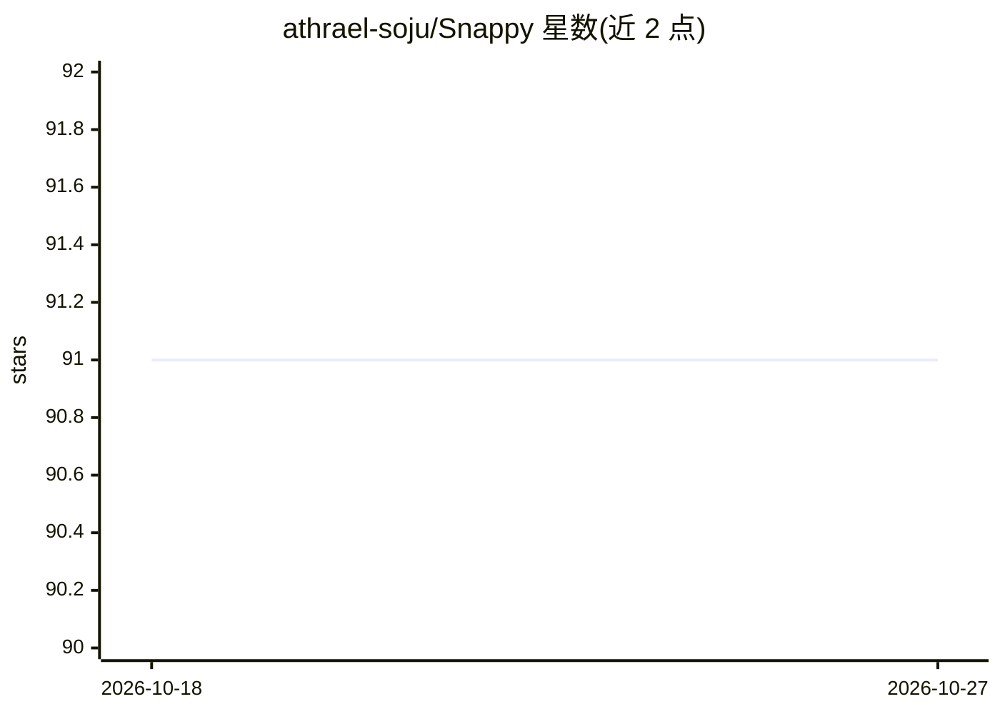

# athrael-soju/Snappy

⭐ 91 · Python · MIT · 推送 2026-02-09 · [GitHub](https://github.com/athrael-soju/Snappy) · 个人维护

**区域级文档检索系统：ColPali 相关性传播过滤 OCR 区域**

基于 FastAPI/Next.js/Qdrant/Docker 的文档检索系统，核心机制是 patch-to-region 相关性传播：将 ViT patch 网格（32×32）与 OCR 边界框做坐标映射，用 ColPali 的 late interaction 相似度经 IoU 加权传播到 OCR 区域，实现两阶段检索（均值池化候选召回 + 全分辨率区域重排），推理时运行、无需额外训练。支持可选的 DeepSeek-OCR-2（3.3B，需 NVIDIA GPU）抽取文本与边界框、可解释性热力图、区域级过滤与二值量化。通过 Docker Compose 一键启动，含前端 UI 与 OpenAPI 文档。

## 筛选速览

| 维度 | 判定 | 备注 |
|---|---|---|
| AI 角色 | `ai-ecosystem` | LLM/agent 周边工具 |
| 许可风险 | `permissive` | MIT |
| 部署形态 | `self-host` | docker 或自建部署 |
| 模型依赖 | — | README 未给出锁定关系 |
| 硬件要求 | — | 无带数字的原话,不猜 |
| 安装摩擦 | `low` | 无编译、无系统依赖或容器化 |
| 成熟度 | — | 结构信号不足 |

## 能力要点

- patch→OCR 区域的 IoU 加权相关性传播，两阶段检索
- 推理时运行，无需额外训练
- 区域级粒度返回（段落/表格/图像而非整页）与 token 级可解释性热力图
- 可选 DeepSeek-OCR-2 结构化抽取，数据存入 Qdrant payload

## 适用场景

- RAG 场景中用区域级检索减少进入上下文窗口的无关内容
- 文档问答时定位并展示与查询匹配的具体段落或图表
- 调试和理解多向量检索结果的空间依据

## 场景标签

`RAG` `语义搜索` · 领域:知识与检索

## 证据(README 行号)

> L21: Snappy implements **region-level document retrieval** by unifying vision-language models with OCR through spatial c
> L27: Snappy bridges these paradigms through **patch-to-region relevance propagation**. The approach formalizes coordinat

## 星数曲线

2026-10-18 91 → 2026-10-27 91（+0）

---
*卡片 v1 · prompt 1.4 · 生成 2026-10-23 · 置信度 high · 依据 README sha `c6ef4cfeefc4` · [字段定义](../../DATASET.md)*
