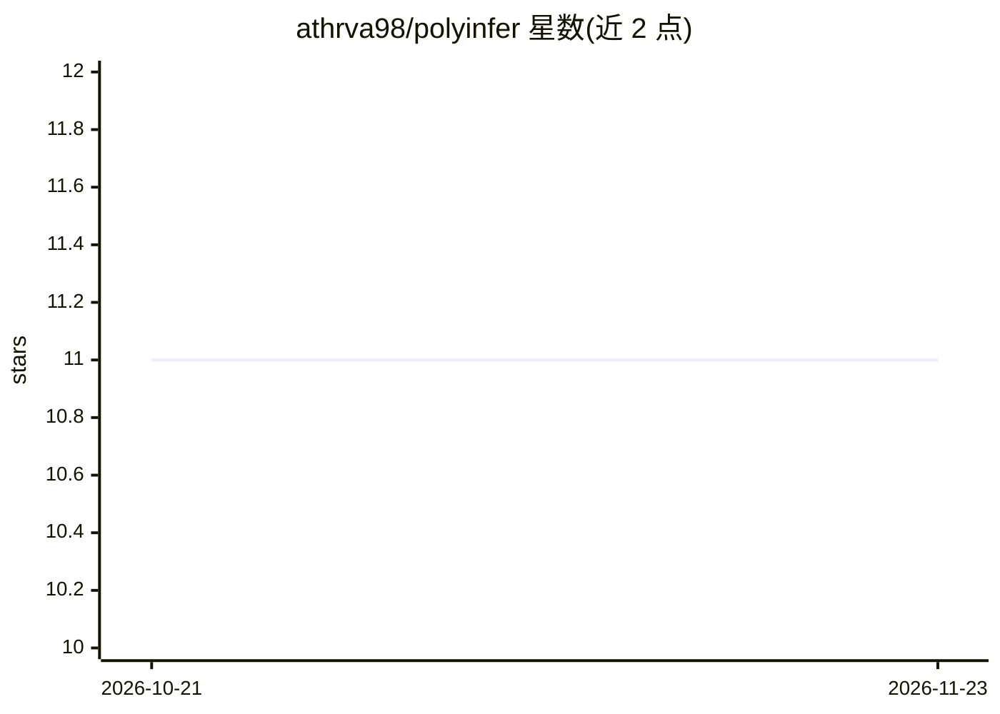

# athrva98/polyinfer

⭐ 11 · Python · Apache-2.0 · 推送 2026-07-27 · [GitHub](https://github.com/athrva98/polyinfer) · 个人维护

**给开发者统一多后端 ML 推理接口与部署流程**

PolyInfer 提供 Python API 与 CLI，通过统一接口在同一代码下调用 ONNX Runtime、OpenVINO、TensorRT、IREE 等推理后端，支持自动后端选择、后端性能对比、INT8/FP16 量化（TensorRT INT8 未实现）、MLIR 导出以及统一异常体系（所有错误继承 PolyInferError）。安装时自动下载配置 CUDA/cuDNN 依赖，覆盖 Windows/Linux/WSL2/Colab，按硬件通过 pip extras（[nvidia]/[intel]/[amd]/[cpu]/[vulkan]/[all]）选择依赖组合。

## 筛选速览

| 维度 | 判定 | 备注 |
|---|---|---|
| AI 角色 | `ai-ecosystem` | LLM/agent 周边工具 |
| 许可风险 | `permissive` | Apache-2.0 |
| 部署形态 | `library` | 以包/库形式分发 |
| 模型依赖 | — | README 未给出锁定关系 |
| 硬件要求 | `cpu-ok` | |
| 安装摩擦 | `medium` | 含编译或系统依赖之一 |
| 成熟度 | — | 结构信号不足 |

## 能力要点

- 统一 API 调用 ONNX Runtime/OpenVINO/TensorRT/IREE 多后端并自动选择
- INT8/FP16 量化：ONNX Runtime 支持 INT4，OpenVINO 经 NNCF 输出 IR
- 导出 MLIR 以用于自定义硬件与内核开发
- 统一异常体系，保留后端原始异常为 __cause__

## 适用场景

- 同一份推理代码在 NVIDIA/Intel/AMD/CPU 硬件间迁移
- 对比各后端在自己硬件上的延迟与吞吐
- 为自定义硬件目标导出 MLIR 做内核开发

## 场景标签

`推理引擎` `模型量化` · 领域:训练与推理

## 证据(README 行号)

> L12: Unified ML inference across multiple backends.
> L188: - **Zero configuration**: `pip install polyinfer[nvidia]` - CUDA, cuDNN, TensorRT all auto-installed
> L167: ## Supported Backends

## 星数曲线

2026-10-21 11 → 2026-11-23 11（+0）

---
*卡片 v1 · prompt 1.4 · 生成 2026-11-18 · 置信度 high · 依据 README sha `9baafe1b459e` · [字段定义](../../DATASET.md)*
