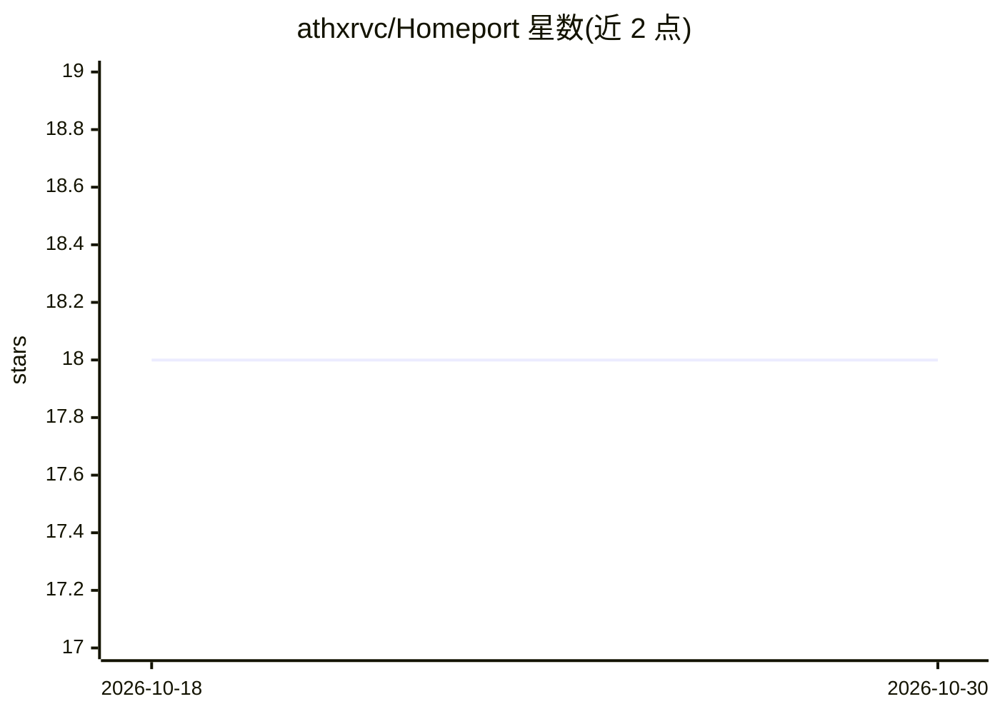

# athxrvc/Homeport

⭐ 18 · PowerShell · MIT · 推送 2026-10-10 · [GitHub](https://github.com/athxrvc/Homeport) · [官网](https://homeport-site.wasmer.app/) · 个人维护

**把本机 Ollama 模型封装为 OpenAI 兼容 API 的自托管网关**

面向自托管用户：Ollama 在本机跑模型，LiteLLM 将 OpenAI API 转换为 Ollama 接口并校验 API key，可选 cloudflared 建免费 Cloudflare Tunnel 或用 Tailscale，使任意 OpenAI 兼容客户端经单一 URL 访问本地模型。仓库内容为预置的 LiteLLM 配置、隧道配置与一键启动脚本，支持临时/固定域名/局域网多种运行方式。限制：仅在电脑与 Ollama 运行时可用；作者声明项目开发中，部分平台与功能未经端到端验证。

## 筛选速览

| 维度 | 判定 | 备注 |
|---|---|---|
| AI 角色 | `ai-ecosystem` | LLM/agent 周边工具 |
| 许可风险 | `permissive` | MIT |
| 部署形态 | `None` |  |
| 模型依赖 | local-ok | 支持本地模型 |
| 硬件要求 | — | 无带数字的原话,不猜 |
| 安装摩擦 | `low` | 无编译、无系统依赖或容器化 |
| 成熟度 | `idea` | |

## 能力要点

- LiteLLM 将 OpenAI API 翻译为 Ollama 接口并强制 API key 鉴权
- 可选 Cloudflare Tunnel（临时/固定域名）、Tailscale Funnel 或仅局域网运行
- macOS/Linux/Windows 一键安装与启动脚本，新拉取模型即时生效
- Ollama 端口不直接暴露，LiteLLM 默认只监听 127.0.0.1

## 适用场景

- 让手机、笔记本或其他设备通过一个 URL 调用家里电脑上的本地模型
- 把现有 OpenAI SDK/聊天 UI/编辑器/agent 指向自建端点，免除按 token 计费
- 以固定域名在自有机器上长期提供私有 LLM API 服务

## 场景标签

`模型网关` · 领域:Agent 开发

## 证据(README 行号)

> L3: *A local LLM API gateway.*
> L9: If you have a model running in Ollama, Homeport gives it an OpenAI-compatible API, protects it with an API key, and 
> L32: This repository is the glue: a ready-made LiteLLM config, tunnel configs, start scripts that wire everything up in 

## 星数曲线

2026-10-18 18 → 2026-10-30 18（+0）

---
*卡片 v1 · prompt 1.4 · 生成 2026-10-29 · 置信度 high · 依据 README sha `7b14317e1fda` · [字段定义](../../DATASET.md)*
