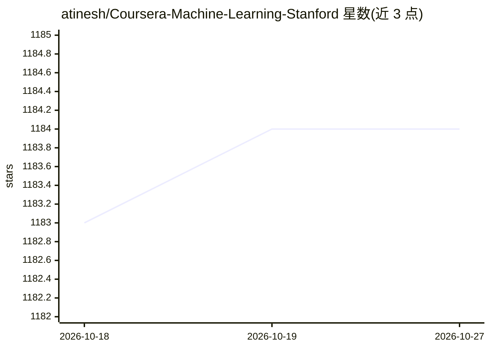

# atinesh/Coursera-Machine-Learning-Stanford

⭐ 1,184 · MATLAB · 推送 2026-06-06 · [GitHub](https://github.com/atinesh/Coursera-Machine-Learning-Stanford) · 个人维护

**Andrew Ng 机器学习课程的作业与测验个人解答集**

个人学习仓库，收录作者完成 Coursera 上斯坦福大学 Andrew Ng《Machine Learning》课程全部编程作业与测验的解答代码。README 建议学习者先自行解题，遇到困难时再参考代码。仓库按课程内容组织目录，附作者获得的课程认证证书与课程官方链接，并提供 issue 渠道报告问题。内容为 Octave/MATLAB 时代课程作业的参考实现，属于学习资料而非可安装运行的软件产品，无安装步骤或依赖说明。

## 筛选速览

| 维度 | 判定 | 备注 |
|---|---|---|
| AI 角色 | `ai-knowledge` | 知识聚合/清单类 |
| 许可风险 | `none` | — |
| 部署形态 | `None` |  |
| 模型依赖 | — | README 未给出锁定关系 |
| 硬件要求 | — | 无带数字的原话,不猜 |
| 安装摩擦 | `low` | 无编译、无系统依赖或容器化 |
| 成熟度 | — | 结构信号不足 |

## 能力要点

- 覆盖课程全部编程作业与测验的解答代码
- 附课程认证证书与 Coursera 课程官方链接
- 提供 issue 渠道报告代码问题

## 适用场景

- 学习 Andrew Ng 机器学习课程时对照参考作业解法
- 卡在某个编程作业时查看思路提示

## 场景标签

`教程课程` · 领域:学习与行业

## 证据(README 行号)

> L2: This is my solution to all the programming assignments and quizzes of Machine-Learning (Coursera) taught by Andrew N

## 星数曲线

2026-10-18 1,183 → 2026-10-27 1,184（+1）

---
*卡片 v1 · prompt 1.4 · 生成 2026-10-21 · 置信度 high · 依据 README sha `824bdf42c955` · [字段定义](../../DATASET.md)*
