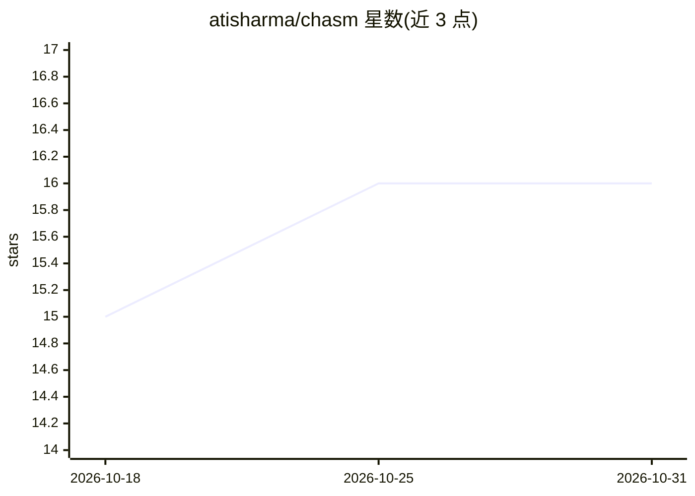

# atisharma/chasm

⭐ 16 · Python · MIT · 推送 2026-09-06 · [GitHub](https://github.com/atisharma/chasm) · [官网](https://chasm.run) · 个人维护

**LLM 驱动的单人文字冒险游戏，世界状态以 markdown 持久化**

单人生成式互动小说游戏：玩家通过自然语言指令行动，语言模型担任叙述者实时生成场景与角色。区别于直接与聊天机器人扮演，地点、角色、对话、事件等状态在会话间持久保存；每个世界是一个 markdown 文件组成的 git 仓库，可分发他人继续游玩。基于 pi coding harness 运行，需配置支持工具调用的模型（可经 OpenRouter 或本地 vLLM），通过 chasm new/play 命令行操作，提供 chasm update 更新机制与 /save、/sync 等游戏内命令。

## 筛选速览

| 维度 | 判定 | 备注 |
|---|---|---|
| AI 角色 | `ai-native` | 本体是模型或模型工具 |
| 许可风险 | `permissive` | MIT |
| 部署形态 | `None` |  |
| 模型依赖 | local-ok | 支持本地模型 |
| 硬件要求 | — | 无带数字的原话,不猜 |
| 安装摩擦 | `low` | 无编译、无系统依赖或容器化 |
| 成熟度 | — | 结构信号不足 |

## 能力要点

- 世界状态（地点/角色/对话/事件）在会话间持久保存
- 每个世界是 markdown 文件的 git 仓库，可分发续玩
- 支持会话中 Ctrl+L 切换模型，可配置本地 vLLM 模型
- chasm update 刷新模板与 CLI 且不动游戏内容

## 适用场景

- 玩由 LLM 实时生成场景与角色的文字冒险
- 创建自定义世界观并保存进度跨会话继续
- 把世界 git 仓库分享给他人接力游玩

## 场景标签

 · 领域:游戏/互动小说

## 证据(README 行号)

> L6: uses generative artificial intelligence (LLMs) to generate scenes and
> L90: Type natural language to act in the world. The narrator interprets your

## 星数曲线

2026-10-18 15 → 2026-10-31 16（+1）

---
*卡片 v1 · prompt 1.4 · 生成 2026-10-30 · 置信度 high · 依据 README sha `03487a4a67f7` · [字段定义](../../DATASET.md)*
