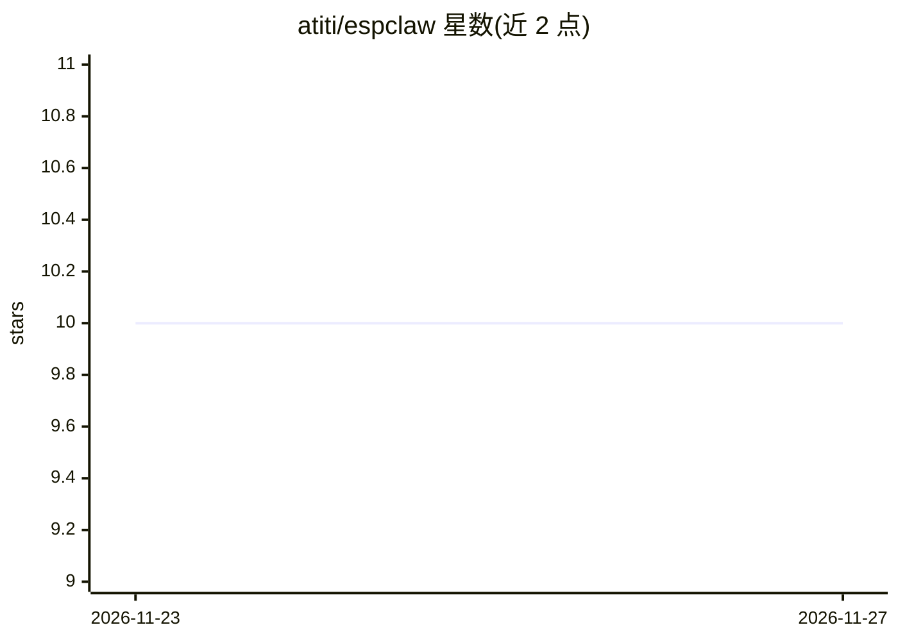

# atiti/espclaw

⭐ 10 · C · MIT · 推送 2026-03-21 · [GitHub](https://github.com/atiti/espclaw) · 个人维护

**在 ESP32 上运行 LLM agent 的嵌入式运行时固件**

面向带传感器、GPIO、摄像头与 Wi-Fi 的 ESP32 开发板的 agent 运行时固件。核心机制为迭代式 LLM 工具循环（远程模型、本地工具执行），配以可热替换的 Lua 应用/组件体系（apps、components、tasks、behaviors、events 五类模型）、设备端管理 UI、UART 控制台、Telegram bot 控制与相机拍照回复。提供主机模拟器（cmake 构建）与固件构建两条路径，固件需本地引导 ESP-IDF v5.5.2 编译；支持 OTA 更新与分块大文件传输。主要目标板为 esp32s3 与 AI Thinker esp32cam。

## 筛选速览

| 维度 | 判定 | 备注 |
|---|---|---|
| AI 角色 | `ai-ecosystem` | LLM/agent 周边工具 |
| 许可风险 | `permissive` | MIT |
| 部署形态 | `None` |  |
| 模型依赖 | — | README 未给出锁定关系 |
| 硬件要求 | — | 无带数字的原话,不猜 |
| 安装摩擦 | `medium` | 含编译或系统依赖之一 |
| 成熟度 | — | 结构信号不足 |

## 能力要点

- 远程模型 + 本地工具执行的迭代 LLM 工具循环
- Lua 应用/组件/任务/行为/事件五层运行时模型，免重新烧录即可替换逻辑
- admin web UI、UART、模拟器、Telegram 共享同一操作者模型与 slash 命令
- 支持 OTA 更新与 board-aware 硬件能力发现

## 适用场景

- 在 ESP32 上搭建可对话控制的传感器监测与自动化任务
- 通过 Telegram 远程控制板卡并获取相机照片
- 用可复用 Lua 组件编写传感器驱动与共享逻辑
- 在主机模拟器中先验证应用再部署到固件

## 场景标签

`Agent 框架` `聊天机器人` · 领域:Agent 开发

## 证据(README 行号)

> L12: ESPClaw is an ESP32-native agent runtime for boards with real sensors, real I/O, and real constraints.
> L41: - remote models, local tool execution
> L15: - an iterative LLM tool loop

## 星数曲线

2026-11-23 10 → 2026-11-27 10（+0）

---
*卡片 v1 · prompt 1.4 · 生成 2026-11-23 · 置信度 high · 依据 README sha `c2372fa56bba` · [字段定义](../../DATASET.md)*
