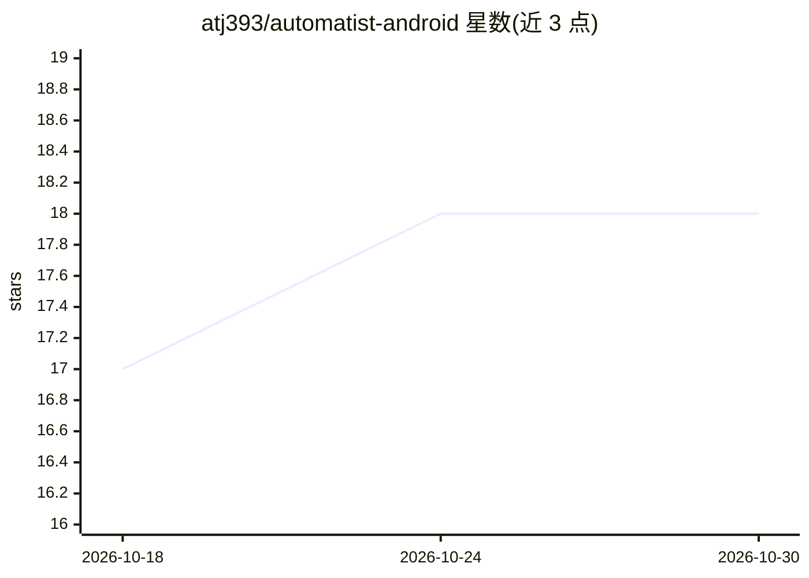

# atj393/automatist-android

⭐ 18 · Kotlin · Apache-2.0 · 推送 2026-10-23 · [GitHub](https://github.com/atj393/automatist-android) · [官网](https://play.google.com/store/apps/details?id=com.automatist.app) · 个人维护

**Android 本地 AI 工作流自动化应用：手机定时运行 AI 任务**

Apache-2.0 的 Android 应用（Kotlin/Jetpack Compose），让用户在手机上编排可复用的动作链（RSS、REST API、URL、笔记、天气、路线等）并插入 AI 处理，按计划运行生成简报、摘要、社交帖等产物，全程无自有后端。AI 接入三种模式：云厂商（OpenAI/Anthropic/Gemini 及 OpenAI 兼容端点，自带 key）、设备端 Gemini Nano（Android AICore）、离线 MediaPipe .task 模型（内置 Gemma 3 1B int4，不支持 .gguf/.safetensors）。限制：后台调度受 Android Doze 与 OEM 电池管理影响，不保证精确执行时间。

## 筛选速览

| 维度 | 判定 | 备注 |
|---|---|---|
| AI 角色 | `ai-native` | 本体是模型或模型工具 |
| 许可风险 | `permissive` | Apache-2.0 |
| 部署形态 | `None` |  |
| 模型依赖 | — | README 未给出锁定关系 |
| 硬件要求 | — | 无带数字的原话,不猜 |
| 安装摩擦 | `medium` | 含编译或系统依赖之一 |
| 成熟度 | — | 结构信号不足 |

## 能力要点

- 11 种动作类型的工作流构建器与模板，支持定时运行（WorkManager）
- 云/设备端/离线三种 AI 模式，离线提示词不出设备，模型 SHA-256 校验
- 无后端：无分析、无追踪、无广告，API key 以 Keystore AES256-GCM 加密存储
- 可选 Google Drive 备份工作流定义到私有 appDataFolder

## 适用场景

- 每天早上把 RSS 订阅自动汇总成一份简报
- 把文章或会议记录转换成摘要、帖子或行动清单
- 无网无 key 环境下用离线模型在手机上跑工作流

## 场景标签

`工作流自动化` `AI 写作` · 领域:效率与自动化

## 证据(README 行号)

> L32: - **Automate recurring AI tasks** such as summaries, briefs, social posts, and digests, on a schedule.
> L71: |**Cloud**|OpenAI, Anthropic, Google Gemini, or any user-configured OpenAI-compatible endpoint|Sent **directly** to
> L137: - **Cloud:** OpenAI, Anthropic, Google Gemini, and any OpenAI-compatible endpoint you configure with your own base

## 星数曲线

2026-10-18 17 → 2026-10-30 18（+1）

---
*卡片 v1 · prompt 1.4 · 生成 2026-10-29 · 置信度 high · 依据 README sha `d473bc5212a1` · [字段定义](../../DATASET.md)*
