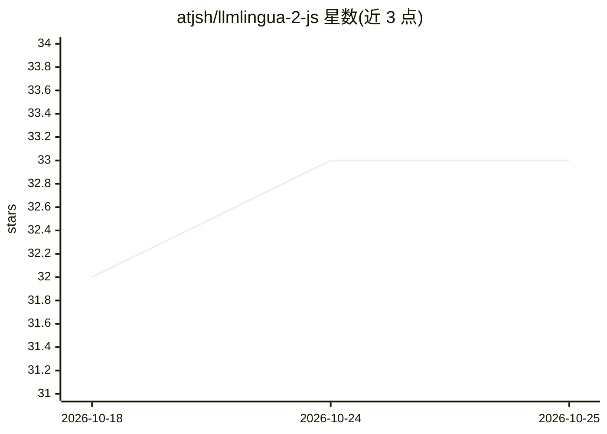

# atjsh/llmlingua-2-js

⭐ 33 · TypeScript · MIT · 推送 2026-08-17 · [GitHub](https://github.com/atjsh/llmlingua-2-js) · [官网](https://atjsh.github.io/llmlingua-2-js/) · 个人维护

**LLMLingua-2 提示压缩的纯 JS/TS 移植库，浏览器/Node 可运行**

由 atjsh 移植的 LLMLingua-2（原 Microsoft Python 实现）的 JavaScript/TypeScript 版本，用于基于 BERT 量级模型的提示压缩，可在浏览器与 Node.js 环境运行，支持 WebGPU/DirectML/CUDA 后端配置（需显式传入且无自动回退）。依赖 @huggingface/transformers 与 js-tiktoken，模型文件默认自动下载，提供 4 种可选模型（TinyBERT 57.1MB 至 XLM-RoBERTa 2240MB）。README 标注为实验性，单元测试暂不可用，E2E 测试部分提供。

## 筛选速览

| 维度 | 判定 | 备注 |
|---|---|---|
| AI 角色 | `ai-ecosystem` | LLM/agent 周边工具 |
| 许可风险 | `permissive` | MIT |
| 部署形态 | `library` | 以包/库形式分发 |
| 模型依赖 | — | README 未给出锁定关系 |
| 硬件要求 | — | 无带数字的原话,不猜 |
| 安装摩擦 | `medium` | 含编译或系统依赖之一 |
| 成熟度 | `idea` | |

## 能力要点

- LLMLingua-2 提示压缩逻辑的纯 JS/TS 移植
- 可在浏览器运行，默认无需服务端，支持 WebGPU
- 可显式配置 CPU/WebGPU/CUDA/DirectML 运行后端
- 提供 4 种模型选择，模型文件默认自动下载

## 适用场景

- 在浏览器或 Node.js 中压缩 LLM 上下文提示以节省 token
- 为 Web 端 LLM 应用做本地提示压缩
- 选择不同大小的 BERT 量级模型权衡压缩速度与准确性

## 场景标签

`提示工程` · 领域:Agent 开发

## 证据(README 行号)

> L6: **LLMLingua-2**, Originally developed and implemented in Python by Microsoft, is a small-size yet powerful prompt co
> L11: **llmlingua-2-js**, ported by atjsh, is a pure JavaScript/TypeScript implementation of LLMLingua-2, designed to run
> L13: - **Performance**: Everything can be done in the browser. If your environment supports WebGPU, you can use it. Serv

## 星数曲线

2026-10-18 32 → 2026-10-25 33（+1）

---
*卡片 v1 · prompt 1.4 · 生成 2026-10-25 · 置信度 high · 依据 README sha `322041900042` · [字段定义](../../DATASET.md)*
