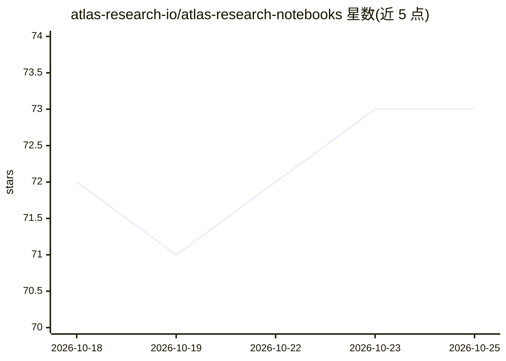

# atlas-research-io/atlas-research-notebooks

⭐ 73 · Python · MIT · 推送 2026-02-11 · [GitHub](https://github.com/atlas-research-io/atlas-research-notebooks) · [官网](https://atlas-research.io) · 组织维护

**加密/经济/地理/ML 主题的开源研究笔记本集合**

由 Atlas Research 平台产出的开源 Jupyter 研究笔记本集合，覆盖加密货币市场分析（相关性、隐含波动率、市场状态检测等 6 篇）、宏观经济指标（FRED、央行资产负债表等 4 篇）、地理可视化（2 篇）、机器学习论文实现（Transformer）与 Python 基础教程。仓库以 Jupytext percent 格式存储 .py 文件替代 .ipynb，以获得干净的 git diff 与代码评审体验；部分笔记本需要 FRED API key，多数使用免费公开 API。

## 筛选速览

| 维度 | 判定 | 备注 |
|---|---|---|
| AI 角色 | `ai-knowledge` | 知识聚合/清单类 |
| 许可风险 | `permissive` | MIT |
| 部署形态 | `library` | 以包/库形式分发 |
| 模型依赖 | — | README 未给出锁定关系 |
| 硬件要求 | — | 无带数字的原话,不猜 |
| 安装摩擦 | `low` | 无编译、无系统依赖或容器化 |
| 成熟度 | — | 结构信号不足 |

## 能力要点

- 覆盖 crypto/经济/地理/ML/编程五大类的研究笔记本
- 用 Jupytext percent 格式存储 .py 文件实现干净版本控制
- 数据来源包括 CCXT、FRED API、World Bank 等公开接口
- 支持本地 Jupyter、VS Code 与 Google Colab 运行

## 适用场景

- 学习加密货币市场与宏观经济数据的分析方法
- 参考 Transformer 等论文的完整实现
- 了解 Jupytext 管理笔记本的工程实践
- 作为量化/金融研究的代码起点

## 场景标签

`金融量化` `教程课程` · 领域:学习与行业

## 证据(README 行号)

> L10: Open-source research notebooks covering crypto, economics, geography, machine learning, and more. Built with Jupyte
> L51: Implementations of foundational ML papers and algorithms.

## 星数曲线

2026-10-18 72 → 2026-10-25 73（+1）

---
*卡片 v1 · prompt 1.4 · 生成 2026-10-24 · 置信度 mid · 依据 README sha `dfbbbaa4e4d0` · [字段定义](../../DATASET.md)*
