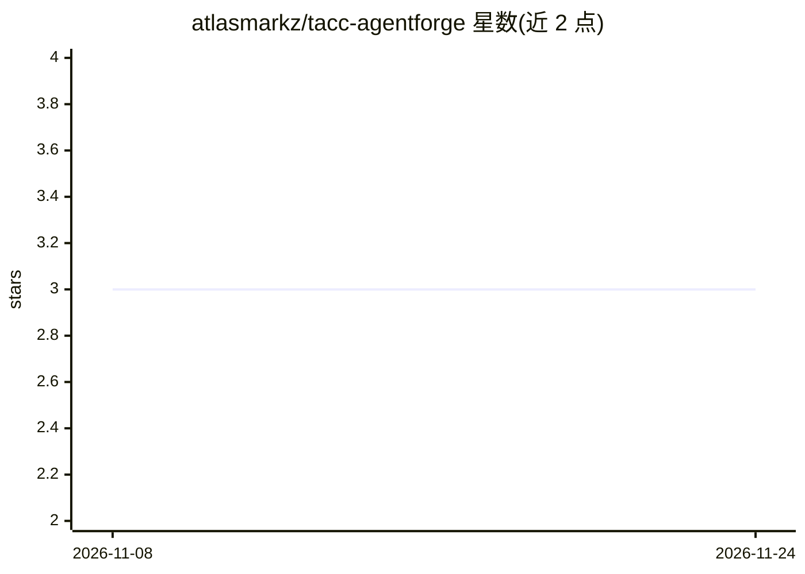

# atlasmarkz/tacc-agentforge

⭐ — · [GitHub]() · 个人维护

**基于 TACC 集群与量化 27B 模型的购物推荐 agent（课程项目）**

CSIT6000V 课程项目：用户描述需求与预算，agent 在带来源链接的商品目录中检索比价，用精确十进制运算校验方案是否超预算，并给出带引用的推荐说明。模型为课程提供的 Qwen3.8-27B AWQ INT4 检查点，由 vLLM 在 TACC 集群双 GPU 上服务。仓库含 LangGraph agent 循环、预算校验器、冻结的 SQLite/FTS5 目录快照、42 条评测用例与原始结果、LoRA SFT 试点与约 700 个离线自动化测试；仓库不含模型权重与凭证。入门路径无需 GPU 与 TACC 账号，用脚本替身跑通端到端请求。

## 筛选速览

| 维度 | 判定 | 备注 |
|---|---|---|
| AI 角色 | `ai-native` | 本体是模型或模型工具 |
| 许可风险 | `none` | — |
| 部署形态 | `None` |  |
| 模型依赖 | local-ok | 支持本地模型 |
| 硬件要求 | — | 无带数字的原话,不猜 |
| 安装摩擦 | `medium` | 含编译或系统依赖之一 |
| 成熟度 | — | 结构信号不足 |

## 能力要点

- 预算校验器用精确十进制运算，五个配置均无超预算方案输出
- LangGraph agent 循环 + 42 条冻结评测用例与可复现原始数据
- vLLM 服务实验：CUDA graphs 输出吞吐 +202%，MTP 投机解码打补丁后单请求 +42%
- 一条命令运行全部无需 GPU 的检查阶段并逐项打印成功/失败

## 适用场景

- 按预算生成带来源链接与明细收据的购物方案
- 复现课程项目的评测基线与服务实验数据
- 在无 GPU 环境验证 artifact 完整性与请求链路

## 场景标签

`RAG` `推荐系统` · 领域:知识与检索

## 证据(README 行号)

> L3:  A TACC-hosted shopping agent that uses a quantized 27B model to recommend products with source links and budget-che
> L11: TACC AgentForge is the course project for **Advanced AI Computing and Systems (CSIT6000V)**. A user describes what 
> L27: |`agent/`|LangGraph agent loop, tools, exact budget validator, checkpoints (internals)|

## 星数曲线

2026-11-08 3 → 2026-11-24 3（+0）

---
*卡片 v1 · prompt 1.4 · 生成 2026-11-22 · 置信度 high · 依据 README sha `7c7aea34c509` · [字段定义](../../DATASET.md)*
