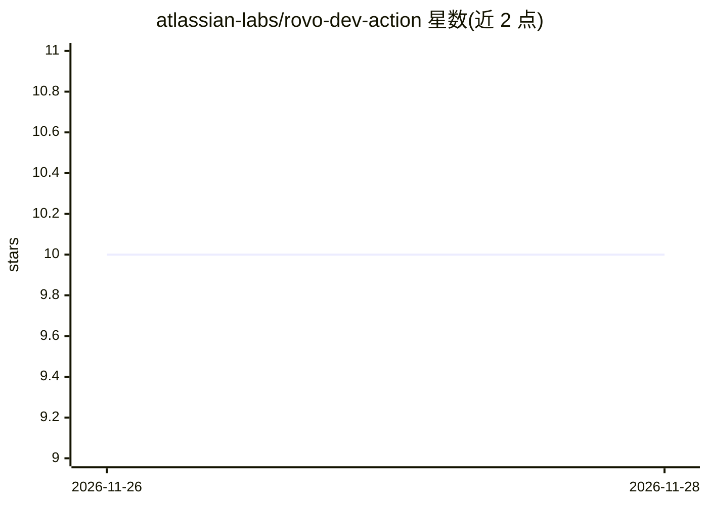

# atlassian-labs/rovo-dev-action

⭐ 10 · Shell · Apache-2.0 · 推送 2025-12-17 · [GitHub](https://github.com/atlassian-labs/rovo-dev-action) · [官网](https://www.atlassian.com/software/rovo-dev) · 组织维护

**在 CI/CD 工作流中运行 Rovo Dev AI agent 的 GitHub Action**

Atlassian Labs 发布的 GitHub Action，用于在 GitHub Actions 工作流中运行 Rovo Dev CLI：接收自定义 prompt 与 Atlassian API token 认证，支持通过 YAML 配置文件控制工具权限，执行后可自动创建包含变更的 Pull Request（可配置标题、正文、基础分支与分支前缀），输出退出码、PR URL 等结果。支持 Linux/macOS/Windows。使用前提是拥有可访问 Rovo Dev 的 Atlassian 账号及其专属 API token，凭据须通过 GitHub Secrets 传入。

## 筛选速览

| 维度 | 判定 | 备注 |
|---|---|---|
| AI 角色 | `ai-ecosystem` | LLM/agent 周边工具 |
| 许可风险 | `permissive` | Apache-2.0 |
| 部署形态 | `None` |  |
| 模型依赖 | — | README 未给出锁定关系 |
| 硬件要求 | — | 无带数字的原话,不猜 |
| 安装摩擦 | `low` | 无编译、无系统依赖或容器化 |
| 成熟度 | — | 结构信号不足 |

## 能力要点

- 在 GitHub Actions 中以自定义 prompt 运行 Rovo Dev CLI
- 自动为 Rovo Dev 产生的变更创建 PR（标题/正文/分支前缀可配置）
- 通过 .rovodev/ci-config.yml 配置文件控制工具权限
- 基于 Atlassian API token 与 GitHub Secrets 的认证方式

## 适用场景

- 在 CI 流水线中让 Rovo Dev 自动更新文档并开 PR
- 以受控的权限配置在 CI 中执行 AI agent 任务
- 将 Rovo Dev CLI 集成进团队的 GitHub Actions 工作流

## 场景标签

`编码 Agent` · 领域:编码与开发

## 证据(README 行号)

> L3: A GitHub Action to run Rovo Dev (Atlassian's developer AI agent) in your CI/CD workflows.
> L7: - 🤖 Run Rovo Dev CLI with custom prompts in GitHub Actions
> L48: |`create_pr`|Whether to automatically create a PR with changes made by Rovo Dev|No|`false`|

## 星数曲线

2026-11-26 10 → 2026-11-28 10（+0）

---
*卡片 v1 · prompt 1.4 · 生成 2026-11-26 · 置信度 high · 依据 README sha `cc4ee355784a` · [字段定义](../../DATASET.md)*
