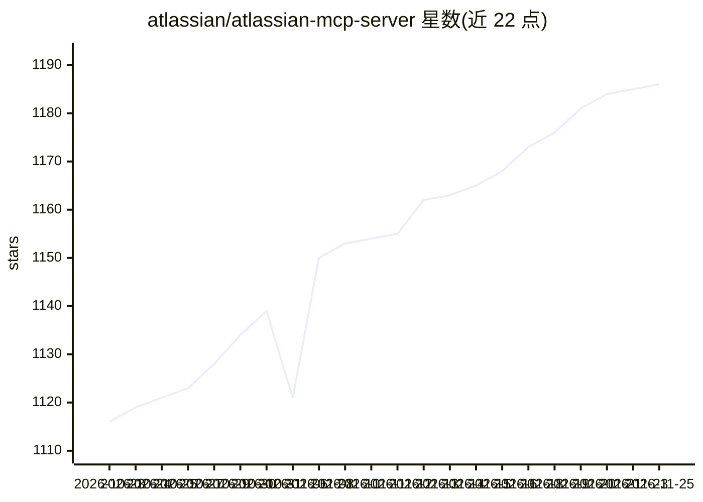

# atlassian/atlassian-mcp-server

⭐ 1,186 · Python · Apache-2.0 · 推送 2026-11-19 · [GitHub](https://github.com/atlassian/atlassian-mcp-server) · [官网](https://atlassian.com/platform/rovo-mcp) · 组织维护

**官方远程 MCP 服务器：让 AI 工具安全读写 Atlassian 数据**

Atlassian 官方提供的云托管 Model Context Protocol 服务器，将 Jira、Confluence、Jira Service Management、Bitbucket、Compass、Loom 及 Atlassian 平台数据（项目、目标、团队等）实时暴露给兼容的 AI 客户端。采用 OAuth 2.1 或 API token 认证，操作遵循用户既有权限。工具按需发现机制只向客户端暴露少量常用工具，其余由客户端按需拉取。支持 Cursor、VS Code、ChatGPT、Claude 等客户端的一键安装，多种插件打包格式，本地客户端经 mcp-remote 代理接入（需 Node.js v18+）。

## 筛选速览

| 维度 | 判定 | 备注 |
|---|---|---|
| AI 角色 | `ai-ecosystem` | LLM/agent 周边工具 |
| 许可风险 | `permissive` | Apache-2.0 |
| 部署形态 | `None` |  |
| 模型依赖 | — | README 未给出锁定关系 |
| 硬件要求 | — | 无带数字的原话,不猜 |
| 安装摩擦 | `low` | 无编译、无系统依赖或容器化 |
| 成熟度 | — | 结构信号不足 |

## 能力要点

- 云托管 MCP 服务器，URL 为 https://mcp.atlassian.com/v2/mcp
- OAuth 2.1 与 API token 双认证路径，操作尊重用户权限
- 工具按需发现机制，保持客户端上下文空间
- 提供 Agent Plugins、Claude Code、Cursor、Gemini 等多种插件打包格式

## 适用场景

- 在 IDE 中引用 Jira issue 并记录工作
- 用自然语言创建和更新 Jira 工单或 Confluence 页面
- 不切换工具即可搜索和摘要 Jira、Confluence、Bitbucket 内容
- 从会议纪要或规格文档自动生成工作项

## 场景标签

 · 领域:开发者工具/AI 集成

## 证据(README 行号)

> L5:  The official Model Context Protocol (MCP) server for Atlassian: a cloud-hosted bridge that gives your AI tools secu
> L41: It's built for developers, content creators, and project teams who work in IDEs or AI tools and want to use Atlassi
> L118: The Atlassian MCP Server also supports any **local MCP-compatible client** that can run on `localhost` and connect

## 星数曲线

2026-10-23 1,116 → 2026-11-25 1,186（+70）

---
*卡片 v1 · prompt 1.4 · 生成 2026-11-23 · 置信度 high · 依据 README sha `0b6434bd7ef4` · [字段定义](../../DATASET.md)*
