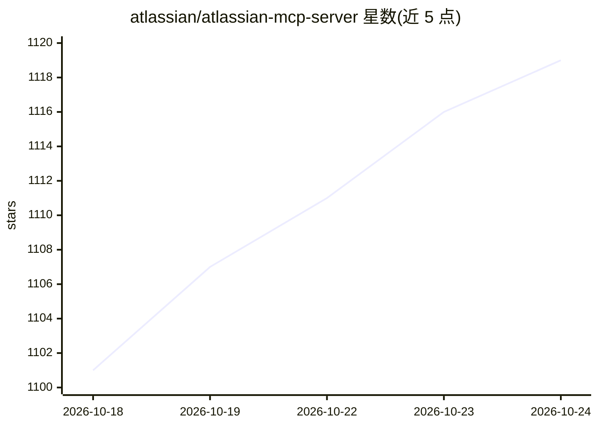

# atlassian/atlassian-mcp-server

⭐ 1,121 · JavaScript · Apache-2.0 · 推送 2026-10-22 · [GitHub](https://github.com/atlassian/atlassian-mcp-server) · [官网](https://atlassian.com/platform/rovo-mcp) · 组织维护

**官方云托管 MCP 服务器：让 AI 工具安全接入 Atlassian 数据**

由 Atlassian 官方维护的云端 MCP（Model Context Protocol）服务器，作为 Atlassian Cloud 站点与外部 AI 客户端之间的桥接层：支持 Jira、Confluence、Jira Service Management、Bitbucket、Compass、Loom 及 Teamwork Graph 数据的读取、搜索、创建与更新。认证采用 OAuth 2.1 或 API token，操作遵循用户既有权限；工具按权限组划分，delete/manage 类默认禁用需管理员开启。面向在 IDE 或 AI 工具中工作的开发者与项目团队，支持一键接入 Cursor、VS Code、ChatGPT、Claude 等客户端。

## 筛选速览

| 维度 | 判定 | 备注 |
|---|---|---|
| AI 角色 | `ai-ecosystem` | LLM/agent 周边工具 |
| 许可风险 | `permissive` | Apache-2.0 |
| 部署形态 | `None` |  |
| 模型依赖 | locked-api |  |
| 硬件要求 | — | 无带数字的原话,不猜 |
| 安装摩擦 | `low` | 无编译、无系统依赖或容器化 |
| 成熟度 | — | 结构信号不足 |

## 能力要点

- 云托管远程 MCP 服务器，端点为 mcp.atlassian.com/v2/mcp
- OAuth 2.1 与 API token 双认证，操作遵循用户既有权限与 IP 允许列表
- 工具按产品与权限组组织，支持按需发现而非全量下发
- 提供 Claude Code/Codex/Cursor/VS Code/Windsurf 等多客户端接入方式

## 适用场景

- 在 IDE 或 AI 聊天工具中直接搜索、总结和创建 Jira/Confluence 内容
- 用自然语言命令自动化创建工作项或页面
- 让 AI 代理从会议记录或规格文档生成工作项

## 场景标签

 · 领域:开发者工具/MCP 服务器

## 证据(README 行号)

> L5:  The official Model Context Protocol (MCP) server for Atlassian: a cloud-hosted bridge that gives your AI tools secu
> L30: The **official Atlassian MCP Server** is a cloud-based bridge between your Atlassian Cloud site and compatible exte
> L89: |Claude Code|`claude mcp add --transport http atlassian https://mcp.atlassian.com/v2/mcp`, then run `/mcp` in a ses

## 星数曲线

2026-10-18 1,101 → 2026-10-24 1,119（+18）

---
*卡片 v1 · prompt 1.4 · 生成 2026-10-21 · 置信度 high · 依据 README sha `93fe3e373095` · [字段定义](../../DATASET.md)*
