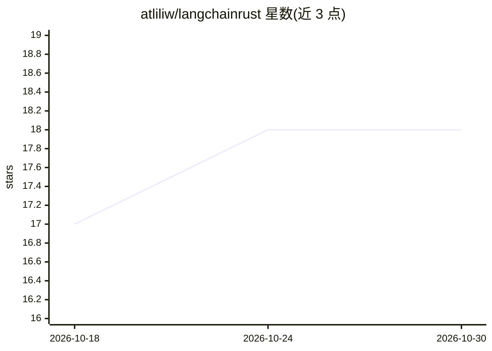

# atliliw/langchainrust

⭐ 18 · Rust · Apache-2.0 · 推送 2026-10-29 · [GitHub](https://github.com/atliliw/langchainrust) · 个人维护 · 中文 README

**Rust 编写的 LLM 应用构建框架：Agent、RAG、工作流**

受 LangChain 启发的纯 Rust LLM 应用框架，面向在 Rust 中构建 LLM 应用的开发者。提供 11 个 LLM 提供商的统一访问 trait 与自动环境检测、OpenAI 兼容端点（vLLM/LM Studio/SGLang/Ollama 等无 key 接入）、LCEL 式 Runnable 组合（pipe）、Agent 执行器（FunctionCalling/ReAct/Plan-Execute/DeepResearch）、RAG 与 BM25/混合检索、Guardrails 与多 Agent Handoffs。嵌入层支持 OpenAI/Qwen/Cohere/FastEmbed 本地 ONNX/Candle 纯 Rust CPU 推理，并含模型路由、成本预算与 LLM 缓存等机制。以 crates.io 包形式分发，通过 cargo 安装。

## 筛选速览

| 维度 | 判定 | 备注 |
|---|---|---|
| AI 角色 | `ai-ecosystem` | LLM/agent 周边工具 |
| 许可风险 | `permissive` | Apache-2.0 |
| 部署形态 | `library` | 以包/库形式分发 |
| 模型依赖 | local-ok | 支持本地模型 |
| 硬件要求 | — | 无带数字的原话,不猜 |
| 安装摩擦 | `low` | 无编译、无系统依赖或容器化 |
| 成熟度 | — | 结构信号不足 |

## 能力要点

- 11 个 LLM 提供商统一 trait，from_env 自动检测，另有通用 OpenAI 兼容端点
- LCEL 式 Runnable 组合：prompt.pipe(llm).pipe(parser) 全链可管道
- Agent 执行器含工具超时、LLM 重试、迭代上限与并发限制
- 嵌入支持本地 ONNX 与 Candle 纯 Rust CPU 推理，含迟到分块（late chunking）端到端路径

## 适用场景

- 在 Rust 项目中构建带工具调用的 Agent 与多 Agent 工作流
- 搭建 RAG 管线，组合 BM25/混合检索与多种向量存储
- 通过 OpenAI 兼容端点接入本地 vLLM/LM Studio/Ollama 等推理服务
- 对 LLM 调用做模型路由、成本预算与缓存控制

## 场景标签

`Agent 框架` `多智能体` `RAG` · 领域:Agent 开发

## 证据(README 行号)

> L10: A LangChain-inspired Rust framework for building LLM applications.
> L12: **What it solves**: Build Agents, RAG, BM25 keyword search, Hybrid retrieval, LangGraph workflows, MCP tools, A2A a
> L34: |**Unified LLM access**|11 providers behind one `BaseChatModel` trait: OpenAI, Ollama, Anthropic Claude, Gemini, Az

## 星数曲线

2026-10-18 17 → 2026-10-30 18（+1）

---
*卡片 v1 · prompt 1.4 · 生成 2026-10-29 · 置信度 high · 依据 README sha `1f2ba3859d0b` · [字段定义](../../DATASET.md)*
