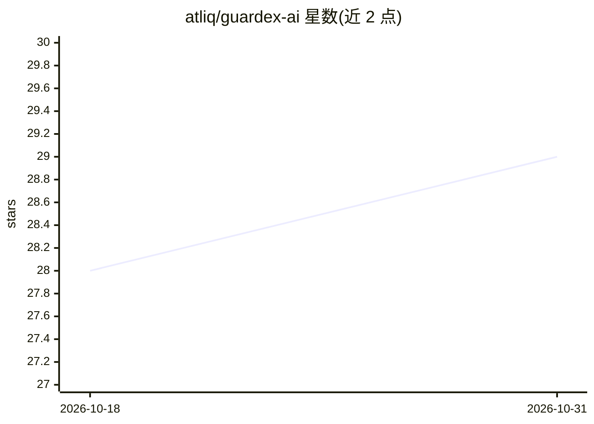

# atliq/guardex-ai

⭐ 29 · Python · Apache-2.0 · 推送 2026-10-13 · [GitHub](https://github.com/atliq/guardex-ai) · [官网](https://pypi.org/project/guardex-ai/) · 组织维护

**本地运行的 LLM 输入输出安全防护 Python SDK**

Python SDK，在 LLM 调用前后拦截内容：毒性二分类（ONNX 快速门控）、31 类 PII 检测与可逆 Vault 令牌化、31 条正则的提示注入防御、可选的 NLI+嵌入幻觉/接地检测、主题范围限制与多轮升级检测。全部在进程内运行，无外部 API；首次调用下载约 250 MB 模型。可选通过 Ollama 接入 LlamaGuard3 获取 S1-S14 完整分类，Ollama 不可用时自动降级为仅 ONNX。支持异步镜像方法、流式处理、YAML 策略配置与 FastAPI 参考服务器。限制：仅英文模式、无内置鉴权、不做图像/音频审核。

## 筛选速览

| 维度 | 判定 | 备注 |
|---|---|---|
| AI 角色 | `ai-ecosystem` | LLM/agent 周边工具 |
| 许可风险 | `permissive` | Apache-2.0 |
| 部署形态 | `library` | 以包/库形式分发 |
| 模型依赖 | local-ok | 支持本地模型 |
| 硬件要求 | — | 无带数字的原话,不猜 |
| 安装摩擦 | `medium` | 含编译或系统依赖之一 |
| 成熟度 | — | 结构信号不足 |

## 能力要点

- 进程内全本地运行，无外部 API，零配置约十行代码接入
- 31 类 PII 检测（GLiNER）与跨流式分块的可逆 Vault 令牌恢复
- 可选 Ollama + LlamaGuard3 深度安全分类（S1-S14），不可达时自动降级 ONNX
- 同步方法均有异步镜像（ascreen/astream 等）

## 适用场景

- 在 LLM 应用上线前拦截有毒内容与提示注入攻击
- 对话中需回显个人数据时用 Vault 做可逆脱敏
- RAG 场景做可选的幻觉/接地检查

## 场景标签

 · 领域:AI 安全/LLM 基础设施

## 证据(README 行号)

> L10: GuardEx is a Python SDK that screens LLM inputs and outputs for unsafe content, PII, prompt injection, and optional
> L132: The same two-gate pattern works with any provider - swap the model call and keep the guards.

## 星数曲线

2026-10-18 28 → 2026-10-31 29（+1）

---
*卡片 v1 · prompt 1.4 · 生成 2026-10-26 · 置信度 high · 依据 README sha `7a2633af2057` · [字段定义](../../DATASET.md)*
