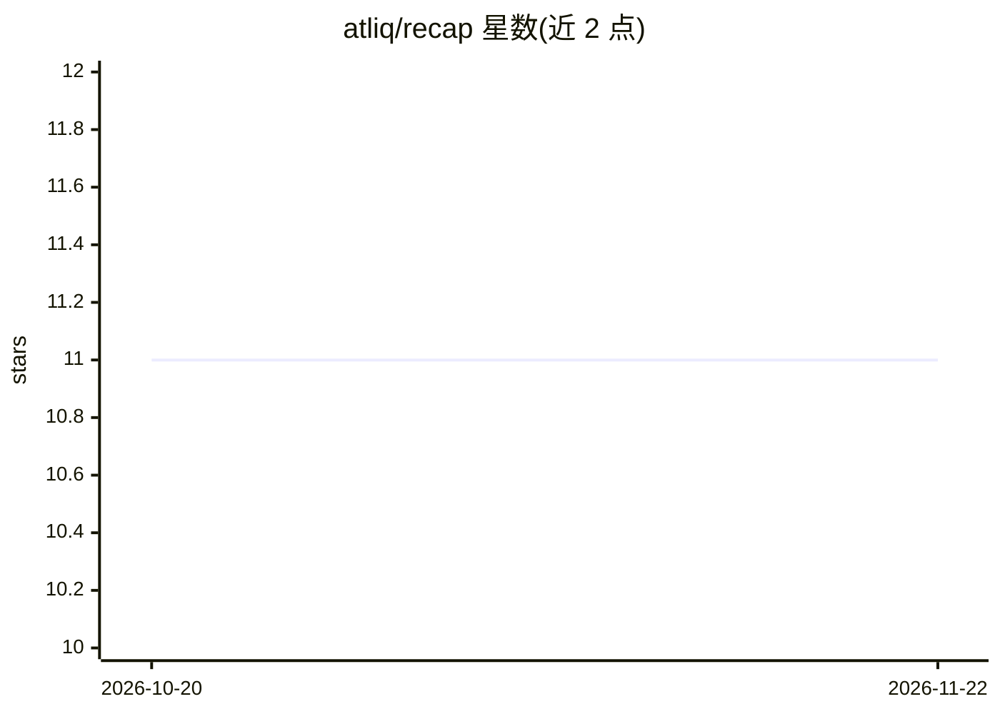

# atliq/recap

⭐ 11 · Python · MIT · 推送 2026-08-04 · [GitHub](https://github.com/atliq/recap) · 个人维护

**本地浏览记录自然语言搜索：Chrome 扩展 + 本地 RAG 后端**

由 Chrome 扩展和本地 Python 后端（FastAPI）组成：扩展追踪用户实际阅读的页面并抽取文本，后端做分块、嵌入与索引（SQLite FTS5 + LanceDB + 小型知识图谱），查询时执行关键词+语义+图谱的混合检索、重排，再交由 LLM 生成带来源引用的回答。数据默认全部留在本机，敏感站点默认跳过，索引按 RETENTION_DAYS（默认 120 天）自动清理。需要配置至少一个 OpenAI 兼容的 LLM 端点。

## 筛选速览

| 维度 | 判定 | 备注 |
|---|---|---|
| AI 角色 | `ai-native` | 本体是模型或模型工具 |
| 许可风险 | `permissive` | MIT |
| 部署形态 | `self-host` | docker 或自建部署 |
| 模型依赖 | local-ok | 支持本地模型 |
| 硬件要求 | — | 无带数字的原话,不猜 |
| 安装摩擦 | `low` | 无编译、无系统依赖或容器化 |
| 成熟度 | — | 结构信号不足 |

## 能力要点

- 混合检索：关键词 + 向量 + 小型知识图谱，重排后由 LLM 作答并附来源引用
- 数据本地化：索引存于本机 SQLite + LanceDB，仅查询时把检索片段发给所选 LLM 提供商
- 默认跳过银行、邮箱、登录、密码管理器等敏感站点
- 3D 知识图谱视图、高亮保存与相关页面重新浮现

## 适用场景

- 用自然语言搜索自己读过的网页内容
- 回答时附带来源引用，追溯出自哪篇浏览过的页面
- 在本地保存网页高亮并重新发现相关已读页面

## 场景标签

`RAG` `知识图谱` `知识库管理` · 领域:知识与检索

## 证据(README 行号)

> L5: A Chrome extension that remembers the pages you read and lets you search them in plain English. It quietly indexes t
> L16: - **Python backend** - a local FastAPI server that chunks and indexes page content, then answers queries with hybri

## 星数曲线

2026-10-20 11 → 2026-11-22 11（+0）

---
*卡片 v1 · prompt 1.4 · 生成 2026-11-18 · 置信度 high · 依据 README sha `18fa94acc4fa` · [字段定义](../../DATASET.md)*
