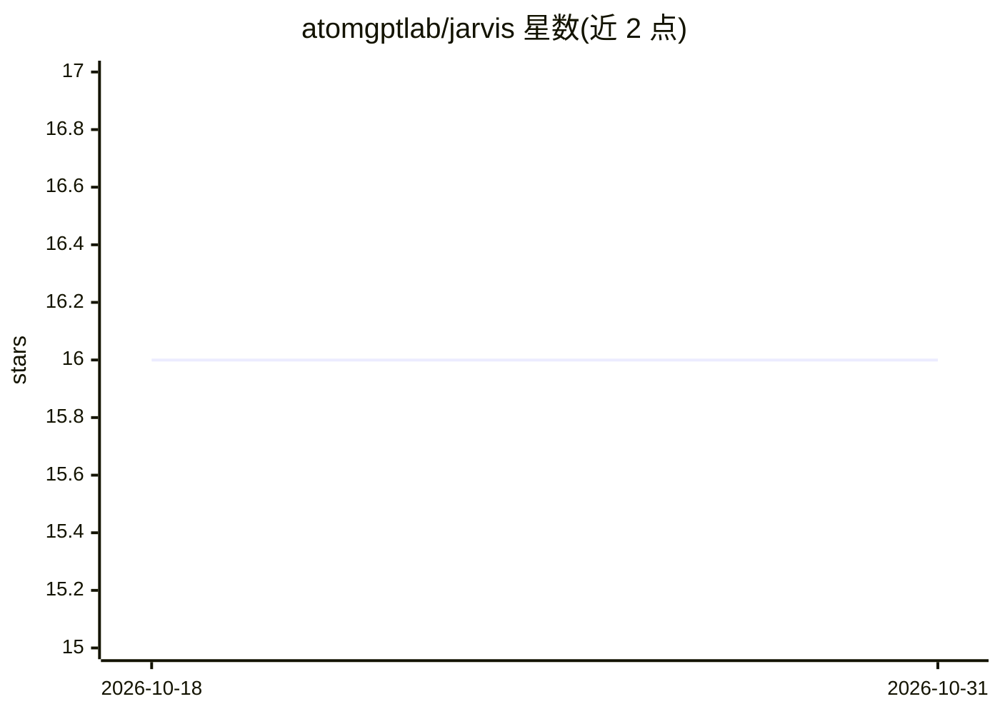

# atomgptlab/jarvis

⭐ 16 · Python · 推送 2026-08-26 · [GitHub](https://github.com/atomgptlab/jarvis) · [官网](https://atomgptlab.github.io/jarvis/) · 组织维护

**面向原子级材料设计的开源数据驱动软件包**

JARVIS-Tools 是用于原子级数据驱动材料设计的开源软件包，功能覆盖计算任务的前期搭建（setting up calculations）、分析与人信息学处理、绘图、数据库开发以及网页开发。项目最初在 usnistgov（美国国家标准与技术研究院）组织下开发，后续更新与开发转至当前仓库，并配有在线文档。README 未给出具体安装命令与硬件要求，需查阅文档获取使用细节。

## 筛选速览

| 维度 | 判定 | 备注 |
|---|---|---|
| AI 角色 | `ai-native` | 本体是模型或模型工具 |
| 许可风险 | `none` | — |
| 部署形态 | `None` |  |
| 模型依赖 | — | README 未给出锁定关系 |
| 硬件要求 | — | 无带数字的原话,不猜 |
| 安装摩擦 | `low` | 无编译、无系统依赖或容器化 |
| 成熟度 | — | 结构信号不足 |

## 能力要点

- 原子级材料设计的数据驱动软件包
- 功能涵盖计算搭建、分析信息学、绘图、数据库与网页开发
- 提供在线文档，项目源自 usnistgov 组织

## 适用场景

- 搭建并分析原子尺度材料模拟计算
- 开展数据驱动的材料信息学研究
- 构建材料数据库与配套网页

## 场景标签

 · 领域:计算材料科学

## 证据(README 行号)

> L3: The JARVIS-Tools is an open-access software package for atomistic
> L4: data-driven materials design. JARVIS-Tools can be used for a) setting up

## 星数曲线

2026-10-18 16 → 2026-10-31 16（+0）

---
*卡片 v1 · prompt 1.4 · 生成 2026-10-30 · 置信度 mid · 依据 README sha `624f92ec2bfe` · [字段定义](../../DATASET.md)*
