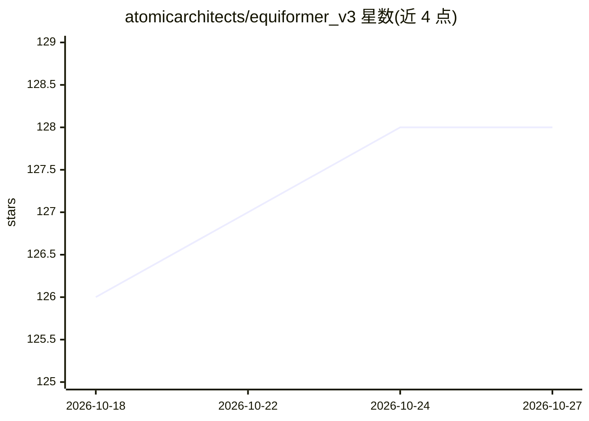

# atomicarchitects/equiformer_v3

⭐ 128 · Python · MIT · 推送 2026-04-17 · [GitHub](https://github.com/atomicarchitects/equiformer_v3) · [官网](https://arxiv.org/abs/2604.09130) · 组织维护

**SE(3)-等变图注意力 Transformer 的官方 PyTorch 实现：材料与分子建模**

论文 "EquiformerV3: Scaling Efficient, Expressive, and General SE(3)-Equivariant Graph Attention Transformers" 的官方实现，基于 fairchem 代码库构建，模型代码置于 experimental 目录。提供在 OC20 S2EF-2M、MPtrj、OMat24、sAlex 数据集上的训练流程，以及 OC20 与 Matbench Discovery（含热导率任务）上的评测脚本，支持 L_max=4 与 L_max=6 配置的预训练与梯度微调。训练脚本示例需多节点多 GPU（如 2×8 GPU 或 4×8 GPU），训练好的 checkpoint 发布在 HuggingFace 页面。面向计算材料与化学领域的科研用户。

## 筛选速览

| 维度 | 判定 | 备注 |
|---|---|---|
| AI 角色 | `ai-native` | 本体是模型或模型工具 |
| 许可风险 | `permissive` | MIT |
| 部署形态 | `None` |  |
| 模型依赖 | — | README 未给出锁定关系 |
| 硬件要求 | — | 无带数字的原话,不猜 |
| 安装摩擦 | `low` | 无编译、无系统依赖或容器化 |
| 成熟度 | — | 结构信号不足 |

## 能力要点

- 提供 OC20/MPtrj/OMat24/sAlex 训练与 Matbench Discovery 评测脚本
- 包含直接预训练、能量头移除与梯度微调的完整流程
- 训练好的 checkpoint 发布于 HuggingFace
- 支持 L_max=4 与 L_max=6 配置

## 适用场景

- 在 OC20/OMat24 等数据集上训练等变机器学习原子间势
- 在 Matbench Discovery 基准上评测模型并输出 F1/RMSD 指标
- 复现论文实验或基于发布 checkpoint 做材料性质预测

## 场景标签

`模型训练` `微调` `模型评测` · 领域:评测与运维

## 证据(README 行号)

> L5: This repository contains the official PyTorch implementation of the work "EquiformerV3: Scaling Efficient, Expressiv
> L6: We provide the code for training on the OC20 S2EF-2M, MPtrj, OMat24, and sAlex datasets and for evaluation on Matben

## 星数曲线

2026-10-18 126 → 2026-10-27 128（+2）

---
*卡片 v1 · prompt 1.4 · 生成 2026-10-23 · 置信度 high · 依据 README sha `f349e37088a6` · [字段定义](../../DATASET.md)*
