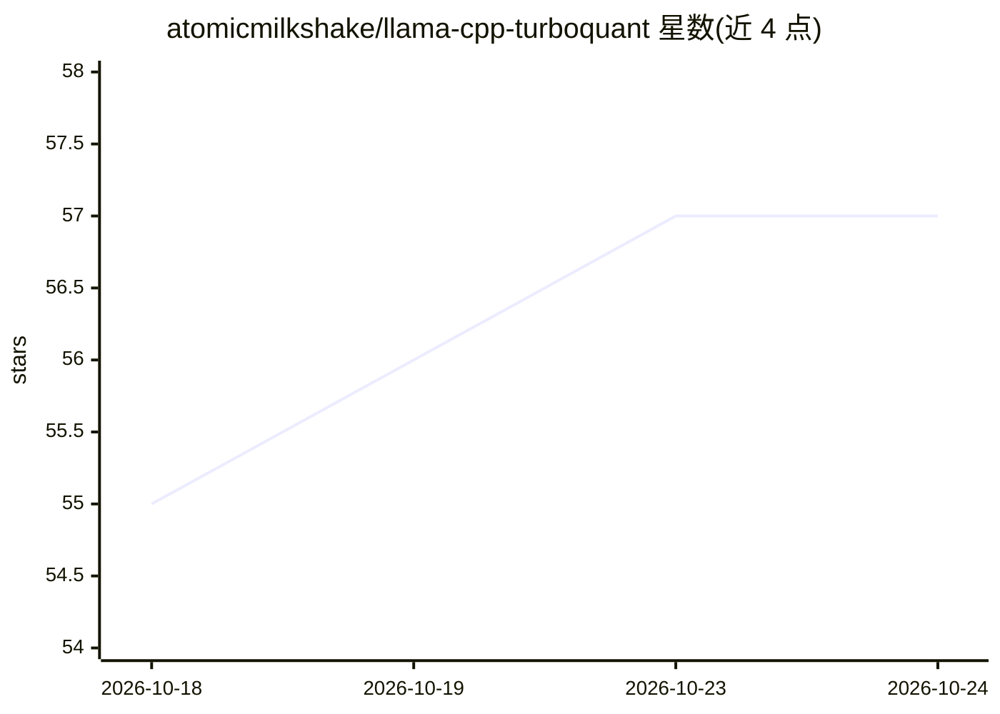

# atomicmilkshake/llama-cpp-turboquant

⭐ 57 · C++ · MIT · 推送 2026-07-02 · [GitHub](https://github.com/atomicmilkshake/llama-cpp-turboquant) · [官网](https://huggingface.co/atomicmilkshake/llama-cpp-turboquant-binaries) · 个人维护

**llama.cpp fork：TurboQuant 低比特量化 + TriAttention KV 缓存剪枝**

在 llama.cpp 基础上加入两项扩展的推理引擎 fork：TurboQuant 提供 turbo2/3/4 三种自定义低比特量化格式（含针对 Turing/Ampere 优化的 CUDA 核），TriAttention 是 GPU 加速的 KV 缓存剪枝（arXiv 2604.04921），利用 RoPE 编码 key 向量的几何结构给 token 重要性打分并驱逐低分 token，在固定显存预算内支持长上下文。README 报告 Qwen3-8B/RTX 3080 上 GPU 打分 75 tok/s。使用需先用代表语料生成 .triattention 校准文件。提供 Windows x64 预编译二进制与源码编译两种途径。

## 筛选速览

| 维度 | 判定 | 备注 |
|---|---|---|
| AI 角色 | `ai-ecosystem` | LLM/agent 周边工具 |
| 许可风险 | `permissive` | MIT |
| 部署形态 | `desktop` | 安装包/桌面程序 |
| 模型依赖 | — | README 未给出锁定关系 |
| 硬件要求 | — | 无带数字的原话,不猜 |
| 安装摩擦 | `high` | 编译与系统依赖俱全 |
| 成熟度 | — | 结构信号不足 |

## 能力要点

- turbo2/3/4 自定义低比特量化格式（2-4 bit）与 CUDA 核
- TriAttention GPU KV 缓存剪枝，固定预算内长上下文推理
- README 报告 GPU 打分约 4-9 ms/次、75 tok/s（Qwen3-8B Q4_K_M / RTX 3080）
- 提供 Windows x64 预编译二进制（CUDA 13, RTX 2000+）

## 适用场景

- 在有限显存内运行更长上下文的本地 LLM 推理
- 用更低比特量化减少模型显存占用
- 通过 llama-server 部署带 KV 剪枝的本地推理服务

## 场景标签

`推理引擎` `模型量化` · 领域:训练与推理

## 证据(README 行号)

> L7: A fork of llama.cpp with two major additions:
> L9: - **TurboQuant** — custom low-bit quantization formats (turbo2, turbo3, turbo4) with hardware-optimised CUDA kernels
> L10: - **TriAttention** — GPU-accelerated KV cache pruning (arXiv 2604.04921) that scores token importance using RoPE-in

## 星数曲线

2026-10-18 55 → 2026-10-24 57（+2）

---
*卡片 v1 · prompt 1.4 · 生成 2026-10-24 · 置信度 high · 依据 README sha `dca57b20a48d` · [字段定义](../../DATASET.md)*
