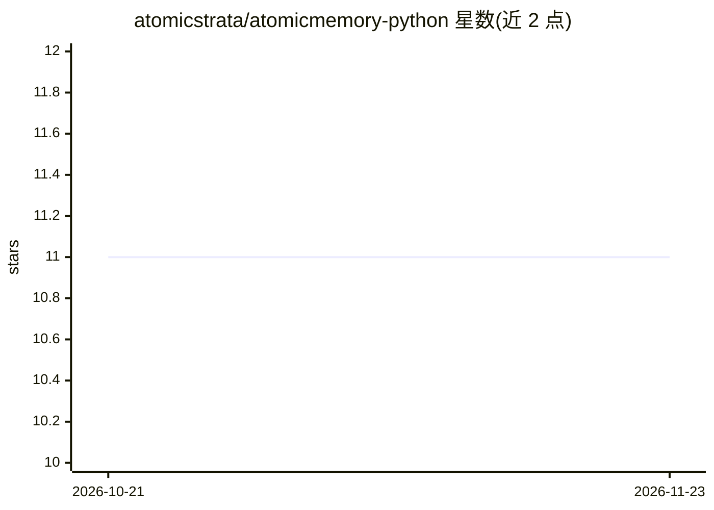

# atomicstrata/atomicmemory-python

⭐ 11 · Python · Apache-2.0 · 推送 2026-10-06 · [GitHub](https://github.com/atomicstrata/atomicmemory-python) · [官网](https://docs.atomicstrata.ai) · 组织维护

**面向 Python 服务与 agent 的 AtomicMemory 记忆存储客户端 SDK**

AtomicMemory 记忆与 artifact 存储的 Python 客户端 SDK，是 TypeScript atomicmemory-sdk 的 1:1 移植，采用 Pydantic 模型与 httpx 同步/异步客户端。功能包括：摄取对话与文档、语义搜索、打包检索上下文、注册/上传 artifact，并通过类型化命名空间访问 lifecycle、audit、lessons、agents/trust 等后端特性。提供 agent 自选记忆工具（JSON Schema 描述符），需先运行 atomicmemory-core 后端；安全限制包括拒绝模型提供的身份字段、限制搜索条数、安全的错误传播。

## 筛选速览

| 维度 | 判定 | 备注 |
|---|---|---|
| AI 角色 | `ai-ecosystem` | LLM/agent 周边工具 |
| 许可风险 | `permissive` | Apache-2.0 |
| 部署形态 | `library` | 以包/库形式分发 |
| 模型依赖 | — | README 未给出锁定关系 |
| 硬件要求 | — | 无带数字的原话,不猜 |
| 安装摩擦 | `low` | 无编译、无系统依赖或容器化 |
| 成熟度 | — | 结构信号不足 |

## 能力要点

- 同步/异步双客户端（httpx + Pydantic），镜像 TS SDK 公开接口
- Agent 自选记忆工具：JSON Schema 描述符 + execute，供 agent 框架注册
- 多 provider 支持：atomicmemory、mem0、hindsight
- storage 命名空间支持指针注册与托管上传、流式读取大文件

## 适用场景

- 为 Python agent 服务接入长期记忆层
- 在 notebook 与评测流程中做语义检索与上下文打包
- 管理原始 artifact 的上传、校验与流式读取

## 场景标签

`Agent 记忆` · 领域:Agent 开发

## 证据(README 行号)

> L9: Python client SDK for AtomicMemory memory and artifact storage.
> L13: AtomicMemory Core currently reaches cost-Pareto SOTA on BEAM-100K, BEAM-1M, and LoCoMo10, with BEAM-10M parity agai
> L72: `execute(arguments)`. Register those with your agent framework and serialize

## 星数曲线

2026-10-21 11 → 2026-11-23 11（+0）

---
*卡片 v1 · prompt 1.4 · 生成 2026-11-18 · 置信度 high · 依据 README sha `fa529b002bc5` · [字段定义](../../DATASET.md)*
