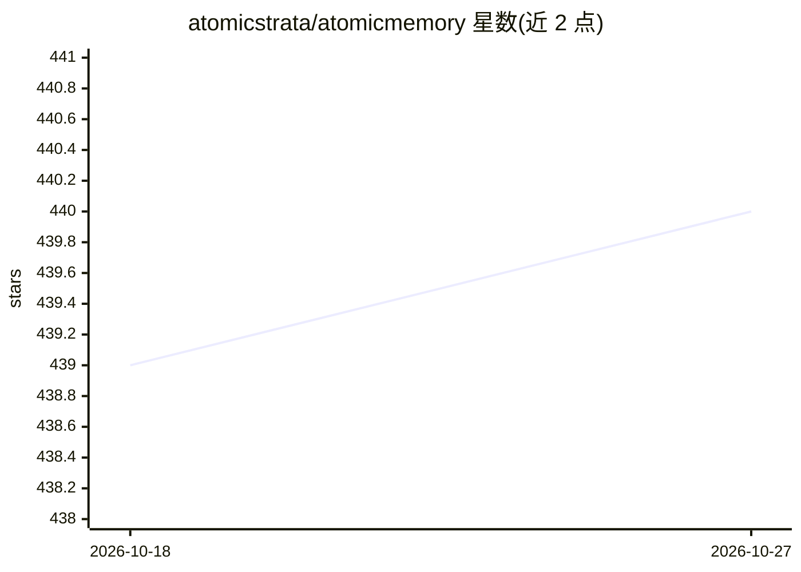

# atomicstrata/atomicmemory

⭐ 440 · TypeScript · NOASSERTION · 推送 2026-10-24 · [GitHub](https://github.com/atomicstrata/atomicmemory) · [官网](https://docs.atomicstrata.ai) · 组织维护

**给 AI agent 的可审计语义记忆层：Core 后端+SDK+MCP+CLI**

为 agent 与 AI 应用提供跨会话持久记忆的开源基础设施：Core 为 Docker 部署的记忆后端（Postgres/pgvector 存储，支持 supersede/clarify/delete 等修正感知操作），外围提供 TypeScript SDK、MCP server、Rust CLI、框架适配器（LangChain/LangGraph/OpenAI Agents/Vercel AI/Mastra）与 agent host 插件。可走托管 Cloud 或本地运行 Core；本地需 Docker 与 OpenAI API key。模型相关能力（抽取、嵌入、重排序）置于显式 provider 边界之后，不绑定单一模型或框架。

## 筛选速览

| 维度 | 判定 | 备注 |
|---|---|---|
| AI 角色 | `ai-ecosystem` | LLM/agent 周边工具 |
| 许可风险 | `permissive` | NOASSERTION |
| 部署形态 | `library` | 以包/库形式分发 |
| 模型依赖 | — | README 未给出锁定关系 |
| 硬件要求 | — | 无带数字的原话,不猜 |
| 安装摩擦 | `low` | 无编译、无系统依赖或容器化 |
| 成熟度 | `idea` | |

## 能力要点

- Core 后端提供 mutation/retrieval 与 Postgres/pgvector 存储，可本地 Docker 运行
- 修正感知记忆：supersede/clarify/delete/retain，非 append-only
- MCP server、CLI、SDK、5 个框架适配器与多个 host 插件统一记忆协议
- Hosted Cloud 与本地 Core 双路径，集成面不随部署切换改写

## 适用场景

- 让我的 agent 在会话之间保留并修正用户偏好与事实
- 通过 MCP 把记忆接入 Cursor、Claude Code 等 agent host
- 在服务端用 TypeScript/Python SDK 为应用接入可审计的记忆层

## 场景标签

`Agent 记忆` · 领域:Agent 开发

## 证据(README 行号)

> L12: AtomicMemory gives agents durable context across sessions without coupling your
> L275: - **Core** — Docker-deployable memory backend with mutation, retrieval, and
> L279: - **CLI and MCP server** — setup, diagnostics, capture, retrieval, and agent

## 星数曲线

2026-10-18 439 → 2026-10-27 440（+1）

---
*卡片 v1 · prompt 1.4 · 生成 2026-10-22 · 置信度 high · 依据 README sha `88da25d99a92` · [字段定义](../../DATASET.md)*
