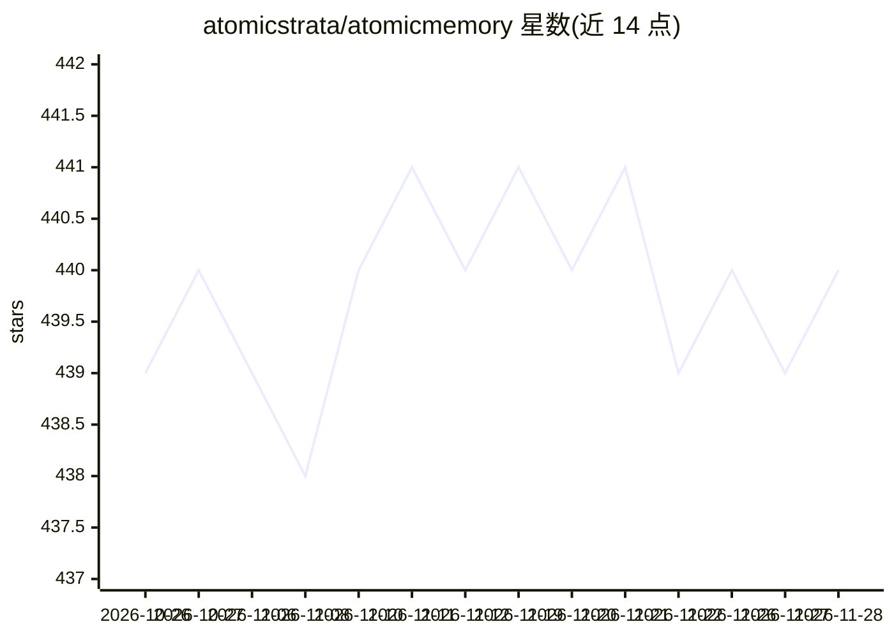

# atomicstrata/atomicmemory

⭐ 440 · TypeScript · NOASSERTION · 推送 2026-11-27 · [GitHub](https://github.com/atomicstrata/atomicmemory) · [官网](https://docs.atomicstrata.ai) · 组织维护

**给 AI agent 提供跨会话持久化、可审计的记忆层**

AtomicMemory 为 agent 和 AI 应用提供可检查、支持更正的语义记忆：通过 am CLI、Docker 化的 Core 引擎、TypeScript SDK、MCP server、框架适配器（OpenAI Agents/LangChain/LangGraph/Mastra/Vercel AI SDK）与主机插件接入。部署路径包括托管 Hosted Cloud 与本地 Core（后者需 Docker 与 OpenAI API key，存储用 Postgres/pgvector）。记忆支持 supersede/clarify/delete 等更正操作而非仅追加。npm 包矩阵标注 published/deprecated/coming soon 等状态。

## 筛选速览

| 维度 | 判定 | 备注 |
|---|---|---|
| AI 角色 | `ai-ecosystem` | LLM/agent 周边工具 |
| 许可风险 | `permissive` | NOASSERTION |
| 部署形态 | `library` | 以包/库形式分发 |
| 模型依赖 | — | README 未给出锁定关系 |
| 硬件要求 | — | 无带数字的原话,不猜 |
| 安装摩擦 | `low` | 无编译、无系统依赖或容器化 |
| 成熟度 | — | 结构信号不足 |

## 能力要点

- CLI 一条命令接入 cursor/claude-code/codex/opencode 等主机（写入 MCP 配置）
- 提供 Hosted Cloud 与本地 Docker Core 两种运行路径，模型调用走 provider 边界
- 修正式记忆管理：supersede、clarify、delete 而非 append-only
- 多框架适配器与主机插件矩阵，标注各包发布状态

## 适用场景

- 为跨会话的 agent 持久保存用户偏好与上下文
- 通过 MCP server 给 Claude Code/Cursor 等主机接入共享记忆
- 在自有服务端用 TypeScript SDK 读写 agent 记忆
- 用本地 Docker Core 自托管并审计记忆的存取路径

## 场景标签

`Agent 记忆` · 领域:Agent 开发

## 证据(README 行号)

> L12: AtomicMemory gives agents durable context across sessions without coupling your
> L92: - **Portable** — use one memory protocol through the CLI, MCP server, SDK,
> L168: Both initialization paths leave an active profile that the published MCP server

## 星数曲线

2026-10-26 439 → 2026-11-28 440（+1）

---
*卡片 v1 · prompt 1.4 · 生成 2026-11-26 · 置信度 mid · 依据 README sha `3d12648411eb` · [字段定义](../../DATASET.md)*
