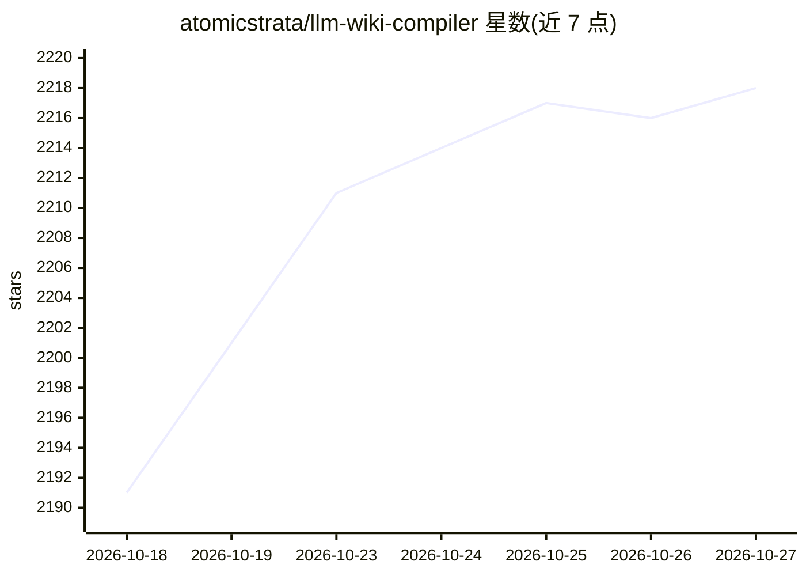

# atomicstrata/llm-wiki-compiler

⭐ 2,218 · TypeScript · MIT · 推送 2026-10-19 · [GitHub](https://github.com/atomicstrata/llm-wiki-compiler) · [官网](https://llmwiki.atomicstrata.ai) · 个人维护

**将原始资料编译为带引用的互联 wiki 的知识编译器**

面向需要持久化知识库的开发者与 agent 使用场景：llmwiki 以两阶段 LLM 流水线从论文、笔记、PDF、网页等原始资料抽取概念并生成带类型与引用的 wiki 页面，实现 Karpathy 的 LLM Wiki 模式——把查询期工作移到编译期。提供配置化的生命周期 Profile、混合检索（语义+BM25+wikilink 图扩展）、本地只读浏览器、lint/eval 健康检查、MCP server 与 TypeScript SDK，支持 OKF/JSON/JSON-LD 等多种导出。限制：不作为通用静态站点生成器或快速变化日志的临时搜索替代。

## 筛选速览

| 维度 | 判定 | 备注 |
|---|---|---|
| AI 角色 | `ai-ecosystem` | LLM/agent 周边工具 |
| 许可风险 | `permissive` | MIT |
| 部署形态 | `library` | 以包/库形式分发 |
| 模型依赖 | local-ok | 支持本地模型 |
| 硬件要求 | — | 无带数字的原话,不猜 |
| 安装摩擦 | `low` | 无编译、无系统依赖或容器化 |
| 成熟度 | — | 结构信号不足 |

## 能力要点

- 两阶段 LLM 流水线生成 concept/entity/comparison/overview 类型页面，段落与声明引用源文件及行号
- 混合检索（语义块搜索+BM25 重排+wikilink 图扩展）构建证据包
- MCP server（llmwiki serve）暴露 ingest/compile/query/lint/eval/context-pack 等工具
- 签名模板分发（Ed25519 签名、密钥轮换、撤销）与 OKF 导入导出

## 适用场景

- 把研究论文、笔记、README 编译成可复用、可审计的知识库
- 为 agent 提供带引用的稳定上下文包而非散落文件
- 建立带评审队列、新鲜度检查与质量门的知识生产流程

## 场景标签

`知识库管理` · 领域:知识与检索

## 证据(README 行号)

> L52: Compile raw sources into an interlinked, citation-traceable markdown wiki that agents and humans can browse, query,
> L80: - **MCP server.** `llmwiki serve` exposes ingest, compile, query, lint, read, status, eval, context-pack, and OKF e
> L117: The key shift is moving work from query time to compile time. Traditional RAG repeatedly retrieves raw chunks and 

## 星数曲线

2026-10-18 2,191 → 2026-10-27 2,218（+27）

---
*卡片 v1 · prompt 1.4 · 生成 2026-10-21 · 置信度 high · 依据 README sha `3091f75f3feb` · [字段定义](../../DATASET.md)*
