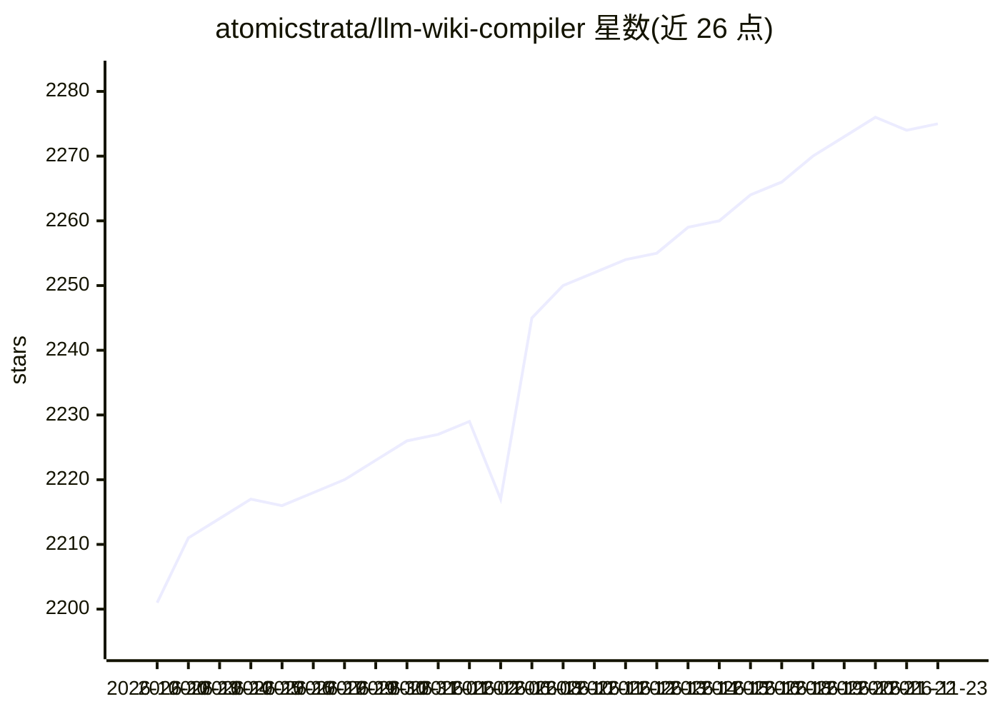

# atomicstrata/llm-wiki-compiler

⭐ 2,275 · TypeScript · MIT · 推送 2026-11-14 · [GitHub](https://github.com/atomicstrata/llm-wiki-compiler) · [官网](https://llmwiki.atomicstrata.ai) · 个人维护

**把原始资料编译为可引用、可复用的互联 wiki 知识库的 CLI**

实现 Karpathy 所述 LLM Wiki 模式的编译器：通过两阶段 LLM 流水线把论文、笔记、README、转录、PDF、网页等源文件一次性编译为带类型页面（concept/entity/comparison/overview）和源引用的 markdown wiki，查询时直接消费已编译产物而非重复检索原始分块。面向需要持久知识库的开发者与 agent 用户，提供 CLI、本地查看器、MCP server、TypeScript SDK 四种入口；通过 .llmwiki/profile.json 声明实体 schema、生命周期状态机与信任门，由运行时强制执行；内置审查队列、新鲜度修复与健康度评估。不适合当通用静态站点生成器或重型本体数据库。

## 筛选速览

| 维度 | 判定 | 备注 |
|---|---|---|
| AI 角色 | `ai-ecosystem` | LLM/agent 周边工具 |
| 许可风险 | `permissive` | MIT |
| 部署形态 | `library` | 以包/库形式分发 |
| 模型依赖 | — | README 未给出锁定关系 |
| 硬件要求 | — | 无带数字的原话,不猜 |
| 安装摩擦 | `low` | 无编译、无系统依赖或容器化 |
| 成熟度 | — | 结构信号不足 |

## 能力要点

- 两阶段 LLM 流水线生成带段落级源引用的 typed wiki 页面
- 混合检索：语义分块搜索 + BM25 重排 + wikilink 图扩展生成证据包
- MCP server 向兼容 agent 暴露 ingest/compile/query/context-pack 等工具
- CLP 生命周期配置：实体 schema、审查门与工作流由运行时强制、fail-closed

## 适用场景

- 把一批论文和实验笔记编译成可查询、可审查的领域知识库
- 给 agent 提供带引用的稳定上下文包而非散乱原始文件
- 通过审查队列保持 AI 生成知识页的可审计与新鲜度

## 场景标签

`知识库管理` · 领域:知识与检索

## 证据(README 行号)

> L68: - Give agents a stable, citation-aware context pack instead of a pile of loose files.
> L87: - **MCP server.** `llmwiki serve` exposes ingest, compile, query, lint, read, status, eval, context-pack, and OKF e
> L88: - **SDK.** `createWiki({ root })` drives ingest, compile, query, context, status, export, eval, and OKF import/expo

## 星数曲线

2026-10-20 2,201 → 2026-11-23 2,275（+74）

---
*卡片 v1 · prompt 1.4 · 生成 2026-11-23 · 置信度 mid · 依据 README sha `0a84b7beacd4` · [字段定义](../../DATASET.md)*
