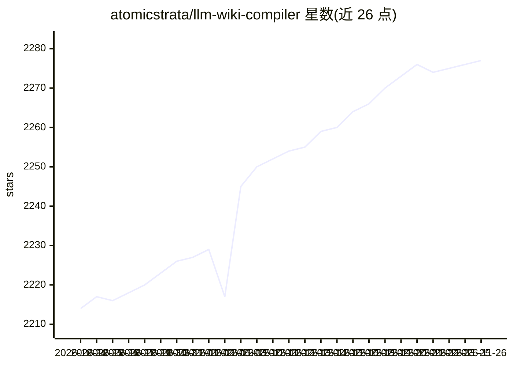

# atomicstrata/llm-wiki-compiler

⭐ 2,277 · TypeScript · MIT · 推送 2026-11-25 · [GitHub](https://github.com/atomicstrata/llm-wiki-compiler) · [官网](https://llmwiki.atomicstrata.ai) · 个人维护

**把原始资料编译成可引用溯源的互联 markdown wiki 的 CLI**

实现 Karpathy 提出的 LLM Wiki 模式的知识编译器：将论文、笔记、PDF、网页等原始资料经两阶段 LLM 流水线（先抽取概念、再生成 concept/entity/comparison/overview 类型页面）编译为带来源引用与行号溯源的互联 wiki，编译一次后供 agent 与人复用，而非每次查询重新检索。提供 CLI、TypeScript SDK、MCP server 与本地只读查看器，支持 BM25 与语义混合检索、审查队列、过期检测修复、健康度评估，可导出 OKF/JSON/GraphML/Marp/llms.txt。通过 npm 全局安装，运行需 Node.js 24+。

## 筛选速览

| 维度 | 判定 | 备注 |
|---|---|---|
| AI 角色 | `ai-native` | 本体是模型或模型工具 |
| 许可风险 | `permissive` | MIT |
| 部署形态 | `library` | 以包/库形式分发 |
| 模型依赖 | local-ok | 支持本地模型 |
| 硬件要求 | — | 无带数字的原话,不猜 |
| 安装摩擦 | `low` | 无编译、无系统依赖或容器化 |
| 成熟度 | — | 结构信号不足 |

## 能力要点

- 两阶段 LLM 流水线生成带行号引用的类型化 wiki 页面
- MCP server 暴露 ingest/compile/query/context-pack 等工具给 agent
- 运行时强制信任门与 fail-closed 的 CLP profile（实体 schema、状态机、审查门）
- 混合检索（语义块搜索+BM25 重排+wikilink 图扩展）生成证据包

## 适用场景

- 把课题组论文和笔记编译成可溯源的知识库供 agent 查询
- 给 agent 提供稳定引用上下文包而不是一堆散乱文件
- 长期积累并审查生成知识，检测修复过期页面
- 以 OKF/JSON/GraphML 等格式与下游系统交换编译后的知识

## 场景标签

`知识库管理` · 领域:知识与检索

## 证据(README 行号)

> L68: Compile raw sources into an interlinked, citation-traceable markdown wiki that agents and humans can browse, query,
> L70: llmwiki implements the LLM Wiki pattern: instead of re-discovering knowledge from raw files at query time, compile 
> L96: - **MCP server.** `llmwiki serve` exposes ingest, compile, query, lint, read, status, eval, context-pack, and OKF e

## 星数曲线

2026-10-24 2,214 → 2026-11-26 2,277（+63）

---
*卡片 v1 · prompt 1.4 · 生成 2026-11-26 · 置信度 high · 依据 README sha `98adc0484671` · [字段定义](../../DATASET.md)*
