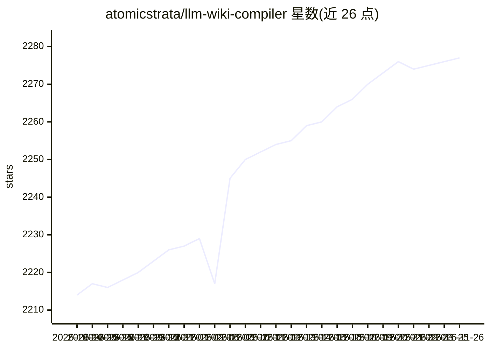

# atomicstrata/llm-wiki-compiler

⭐ 2,277 · TypeScript · MIT · 推送 2026-11-25 · [GitHub](https://github.com/atomicstrata/llm-wiki-compiler) · [官网](https://llmwiki.atomicstrata.ai) · 个人维护

**把原始资料编译成可引用溯源 wiki 的 CLI/SDK，供人和 agent 复用**

实现 Karpathy 提出的 LLM Wiki 模式的知识编译器：以两阶段 LLM 管线将论文、笔记、PDF、网页等原始来源编译为带类型、互链与来源引用的 markdown wiki 页面，并提供检索（语义+BM25+wikilink 图）、审查队列、新鲜度检查、eval 评测、本地只读浏览器视图、MCP server 与 TypeScript SDK。通过可选的 profile.json 定义实体模式、关系与信任门，模板经 Ed25519 签名分发。运行依赖 Node.js 24+；1.6.0-rc.1 为预发布版本，官方提示升级前备份 wiki。

## 筛选速览

| 维度 | 判定 | 备注 |
|---|---|---|
| AI 角色 | `ai-ecosystem` | LLM/agent 周边工具 |
| 许可风险 | `permissive` | MIT |
| 部署形态 | `library` | 以包/库形式分发 |
| 模型依赖 | local-ok | 支持本地模型 |
| 硬件要求 | — | 无带数字的原话,不猜 |
| 安装摩擦 | `low` | 无编译、无系统依赖或容器化 |
| 成熟度 | — | 结构信号不足 |

## 能力要点

- 两阶段管线：先抽取概念再生成 concept/entity/comparison/overview 类型页面
- 段落与论断引用来源文件及行号范围，llmwiki lint 校验链接
- MCP server 暴露 ingest/compile/query/context-pack 等工具给兼容 agent
- 导出 OKF、JSON-LD、GraphML、Marp、llms.txt 等格式

## 适用场景

- 把一批论文和实验笔记沉淀成可持续维护的项目知识库
- 给 agent 提供带引用的稳定上下文包而非散乱原始文件
- 搭建需要审查门与溯源的研究或编辑部知识流程

## 场景标签

`知识库管理` · 领域:知识与检索

## 证据(README 行号)

> L63: Compile raw sources into an interlinked, citation-traceable markdown wiki that agents and humans can browse, query,
> L91: - **MCP server.** `llmwiki serve` exposes ingest, compile, query, lint, read, status, eval, context-pack, and OKF e
> L95: - **Provider portable.** Anthropic, Claude Agent SDK local login, OpenAI Codex CLI local login, OpenAI-compatible s

## 星数曲线

2026-10-24 2,214 → 2026-11-26 2,277（+63）

---
*卡片 v1 · prompt 1.4 · 生成 2026-11-24 · 置信度 high · 依据 README sha `8fc535497734` · [字段定义](../../DATASET.md)*
