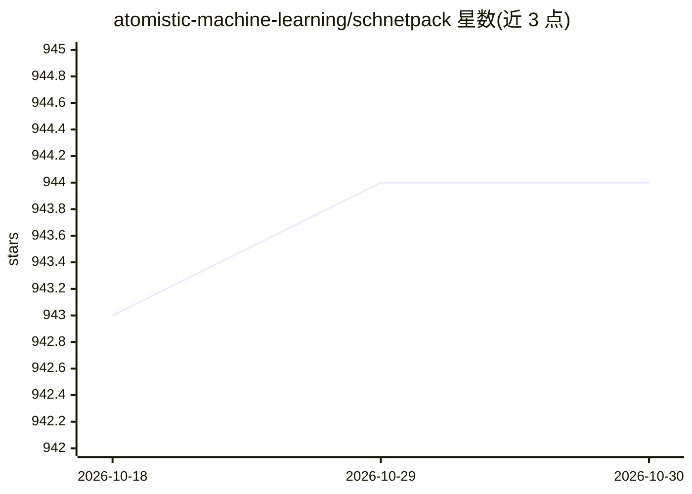

# atomistic-machine-learning/schnetpack

⭐ 944 · Python · NOASSERTION · 推送 2026-10-29 · [GitHub](https://github.com/atomistic-machine-learning/schnetpack) · 组织维护

**原子体系神经网络工具箱：预测分子与材料的量子化学性质**

面向原子体系机器学习的深度学习工具箱：提供 SchNet 连续滤波 CNN 与 PaiNN 等价变消息传递等模型构建模块，用于预测势能面、能量、力、偶极矩、极化率等量子化学性质；管理训练流程并提供对常用基准数据集（QM9、MD17 等）的访问，数据可自动下载。训练基于 PyTorch Lightning 与 Hydra 的分层配置，通过 spktrain 命令行启动；另含 GPU 加速分子动力学代码（含路径积分 MD、恒温恒压）与 LAMMPS 接口。以 pip 包与源码两种方式安装。

## 筛选速览

| 维度 | 判定 | 备注 |
|---|---|---|
| AI 角色 | `ai-native` | 本体是模型或模型工具 |
| 许可风险 | `none` | NOASSERTION |
| 部署形态 | `library` | 以包/库形式分发 |
| 模型依赖 | — | README 未给出锁定关系 |
| 硬件要求 | — | 无带数字的原话,不猜 |
| 安装摩擦 | `low` | 无编译、无系统依赖或容器化 |
| 成熟度 | — | 结构信号不足 |

## 能力要点

- SchNet 与 PaiNN 等原子神经网络模型及偶极矩/极化率/应力等输出模块
- 基于 Hydra 配置的 spktrain CLI 训练，基准数据集自动下载
- GPU 加速分子动力学代码（含路径积分 MD、恒温恒压器）
- 提供 LAMMPS 接口与扩展包机制（如 cG-SchNet 生成模型）

## 适用场景

- 在 QM9/MD17 等基准数据集上训练分子性质预测模型
- 训练神经网络势能面并跑分子动力学模拟
- 作为基础框架实现新的原子体系神经网络模型

## 场景标签

 · 领域:计算化学/材料科学的机器学习

## 证据(README 行号)

> L4: SchNetPack is a toolbox for the development and application of deep neural networks to the prediction of potential e
> L10: - SchNet - an end-to-end continuous-filter CNN for molecules and materials [1-3]
> L14: - GPU-accelerated molecular dynamics code incl. path-integral MD, thermostats, barostats

## 星数曲线

2026-10-18 943 → 2026-10-30 944（+1）

---
*卡片 v1 · prompt 1.4 · 生成 2026-10-21 · 置信度 high · 依据 README sha `cf197c023ae9` · [字段定义](../../DATASET.md)*
