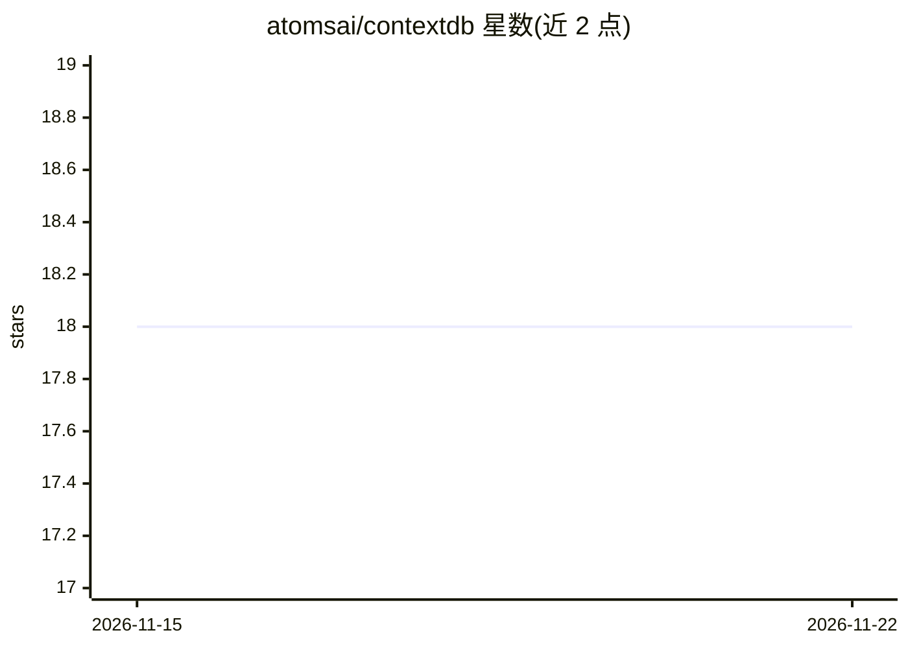

# atomsai/contextdb

⭐ 18 · Python · Apache-2.0 · 推送 2026-11-15 · [GitHub](https://github.com/atomsai/contextdb) · [官网](https://contextdb.ai) · 个人维护

**带信任模型与 PII 防护的 AI agent 记忆引擎（SQLite/Postgres）**

面向 AI agent 开发者的统一记忆层 Python SDK：提供事实记忆、经验记忆与 token 预算的工作记忆三类存储；每条记忆携带认知来源标签（user_stated/agent_inferred/third_party）、置信度与佐证，动作前需通过可配置 TrustPolicy 的 recall_for_action 门控。检索采用语义/时间/因果/实体四图 RRF 融合与 BM25；写入前做 PII 检测脱敏、哈希链审计日志、类型化 TTL 与可验证遗忘。提供 LangChain、OpenAI Agents、CrewAI、AutoGen 适配器及 MCP 支持；默认依赖 SQLite + NumPy，Postgres 可选。

## 筛选速览

| 维度 | 判定 | 备注 |
|---|---|---|
| AI 角色 | `ai-ecosystem` | LLM/agent 周边工具 |
| 许可风险 | `permissive` | Apache-2.0 |
| 部署形态 | `library` | 以包/库形式分发 |
| 模型依赖 | — | README 未给出锁定关系 |
| 硬件要求 | — | 无带数字的原话,不猜 |
| 安装摩擦 | `low` | 无编译、无系统依赖或容器化 |
| 成熟度 | — | 结构信号不足 |

## 能力要点

- 认知来源分型 + TrustPolicy + recall_for_action 动作前门控
- 语义/时间/因果/实体四图 RRF 融合检索与精确标识符召回
- 嵌入前 PII 检测脱敏、哈希链审计日志与类型化保留 TTL
- LangChain / OpenAI Agents / CrewAI / AutoGen 集成适配器

## 适用场景

- 为多会话 agent 提供跨调用持久记忆与事实演化管理
- 客服等动作型 agent 在执行前核验事实来源与确认状态
- 需要 PII 脱敏、审计日志与被遗忘权合规的记忆存储

## 场景标签

`Agent 记忆` · 领域:Agent 开发

## 证据(README 行号)

> L1: ContextDB — The unified context layer for AI agents
> L43: Every memory carries **epistemic provenance** (`user_stated` / `agent_inferred` / `third_party`), **confidence**, *
> L176: ## Framework integrations

## 星数曲线

2026-11-15 18 → 2026-11-22 18（+0）

---
*卡片 v1 · prompt 1.4 · 生成 2026-11-18 · 置信度 high · 依据 README sha `f854cb32b32a` · [字段定义](../../DATASET.md)*
