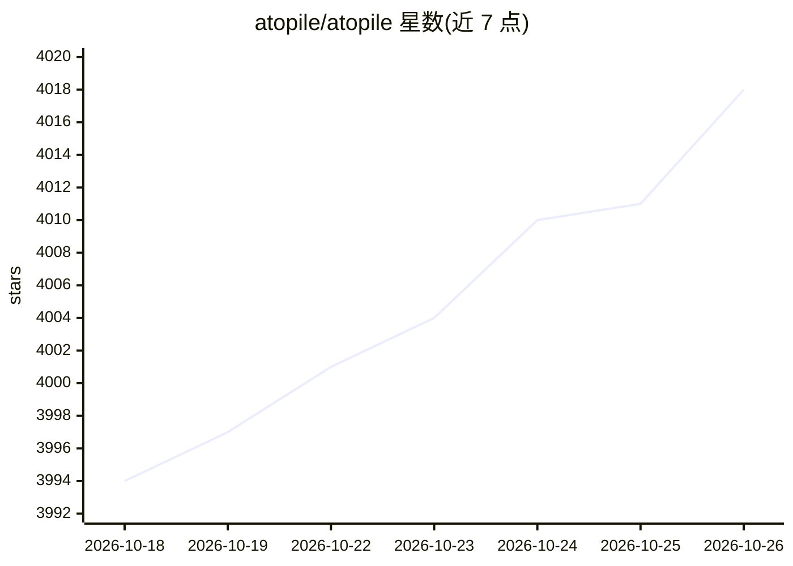

# atopile/atopile

⭐ 4,018 · Python · MIT · 推送 2026-10-14 · [GitHub](https://github.com/atopile/atopile) · [官网](https://atopile.io) · 组织维护

**用代码设计电路板的语言与工具链（.ato + KiCad）**

atopile 提供一种面向电子硬件的声明式语言 .ato、配套编译器与工具链：以模块、接口、单位、容差和断言描述电路，编译器求解约束、参数化选件、执行检查并更新 KiCad 布局，最终产出 BOM 与制造装配数据。面向硬件/电子工程师与开源硬件开发者，通过 VS Code/Cursor 扩展安装，CLI 与 CI 中可运行 `ato build` 与设计检查。KiCad 为可选依赖，仅布局阶段需要；模块可发布到 packages.atopile.io 注册表复用。README 本体未描述 AI 功能，仅示例项目清单中出现 AI 相关命名。

## 筛选速览

| 维度 | 判定 | 备注 |
|---|---|---|
| AI 角色 | `ai-enhanced` | 去掉 AI 部分产品仍成立 |
| 许可风险 | `permissive` | MIT |
| 部署形态 | `library` | 以包/库形式分发 |
| 模型依赖 | — | README 未给出锁定关系 |
| 硬件要求 | — | 无带数字的原话,不猜 |
| 安装摩擦 | `low` | 无编译、无系统依赖或容器化 |
| 成熟度 | — | 结构信号不足 |

## 能力要点

- 声明式 .ato 语言：模块、接口、单位、容差、断言
- 编译器求解约束、参数化选件、运行检查并更新 KiCad 布局
- 产出 BOM 与制造/装配数据，设计检查可本地或 CI 运行
- 模块注册表（packages.atopile.io）支持浏览、安装与发布复用

## 适用场景

- 以软件工程方式（版本控制、复用、验证）设计 PCB
- 用参数化方式自动挑选分立元件
- 在 CI 中对硬件设计运行自动化检查

## 场景标签

 · 领域:电子设计自动化（EDA）/硬件工程

## 证据(README 行号)

> L11: Write hardware like software. atopile is a language, compiler, and toolchain for electronics—declarative `.ato` fil
> L69: - AI-Pin — Vibe-coded Humane Pin https://github.com/atopile/ai-pin

## 星数曲线

2026-10-18 3,994 → 2026-10-26 4,018（+24）

---
*卡片 v1 · prompt 1.4 · 生成 2026-10-20 · 置信度 low · 依据 README sha `10f5b4472ae2` · [字段定义](../../DATASET.md)*
