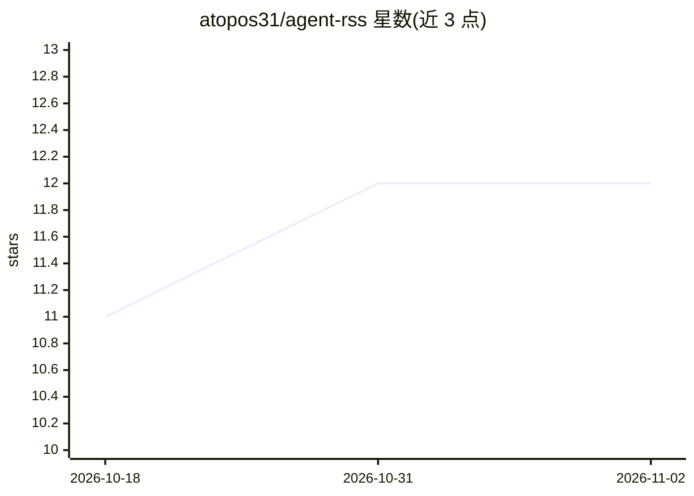

# atopos31/agent-rss

⭐ 12 · Go · MIT · 推送 2026-03-15 · [GitHub](https://github.com/atopos31/agent-rss) · 个人维护 · 中文 README

**面向 AI agent 的 CLI RSS 订阅与抓取工具**

用 Go 编写的命令行 RSS/Atom 工具，供 AI agent 通过 bash 调用：支持订阅管理（add/list 等）、抓取指定或全部订阅源，并可按相对时间（如过去 1 小时/2 天）或关键词过滤条目。输出格式为 NDJSON（默认）或 JSON，订阅保存在 ~/.config/agent-rss/feeds.txt。针对 agent 环境的 bash 输出长度限制，文档建议先写入临时文件再由 agent 读取；也可通过 npx skills add 安装为 agent 技能。

## 筛选速览

| 维度 | 判定 | 备注 |
|---|---|---|
| AI 角色 | `ai-ecosystem` | LLM/agent 周边工具 |
| 许可风险 | `permissive` | MIT |
| 部署形态 | `library` | 以包/库形式分发 |
| 模型依赖 | — | README 未给出锁定关系 |
| 硬件要求 | — | 无带数字的原话,不猜 |
| 安装摩擦 | `low` | 无编译、无系统依赖或容器化 |
| 成熟度 | — | 结构信号不足 |

## 能力要点

- 订阅管理、RSS/Atom 抓取与按时间/关键词过滤
- NDJSON（默认）与 JSON 两种输出格式
- 可安装为支持 skills 的 AI agent 的技能
- 针对 agent 输出限制的写临时文件最佳实践

## 适用场景

- AI agent 定期抓取并读取 RSS 订阅内容
- 按时间或关键词筛选信息源条目供 agent 处理
- 为 Claude Code / OpenClaw 等 agent 环境安装 RSS 技能

## 场景标签

`网页抓取` · 领域:效率与自动化

## 证据(README 行号)

> L5: CLI RSS tool for AI agents. Subscribe to feeds, fetch RSS/Atom content, and filter by time or keywords.
> L75: Many AI agent environments (like Claude Code, OpenClaw, etc.) have **output size limits** for bash commands. When f

## 星数曲线

2026-10-18 11 → 2026-11-02 12（+1）

---
*卡片 v1 · prompt 1.4 · 生成 2026-11-01 · 置信度 high · 依据 README sha `555fa539dc37` · [字段定义](../../DATASET.md)*
