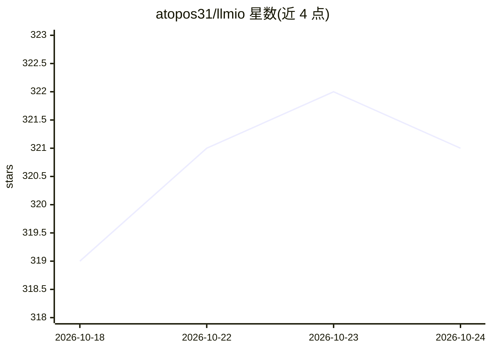

# atopos31/llmio

⭐ 321 · Go · MIT · 推送 2026-10-21 · [GitHub](https://github.com/atopos31/llmio) · 个人维护 · 中文 README

**统一 LLM 网关：权重负载均衡、可观测性与费用追踪**

Go 实现的 LLM 负载均衡网关，对外提供兼容 OpenAI / Anthropic / Gemini 协议的统一 REST API，供 openclaw、Claude Code、Codex、Gemini CLI、Cherry Studio、Open WebUI 等客户端接入。核心机制包括协议桥接（跨协议自动翻译且不静默丢字段）、按权重随机/优先级调度、可按工具调用与多模态能力路由、纯 Go SQLite 本地持久化、内容分块去重压缩、配额余额聚合与分时计价，并配套 React 管理控制台。通过 Docker Compose / Docker 或发布包本地运行，需设置 TOKEN 环境变量。

## 筛选速览

| 维度 | 判定 | 备注 |
|---|---|---|
| AI 角色 | `ai-ecosystem` | LLM/agent 周边工具 |
| 许可风险 | `permissive` | MIT |
| 部署形态 | `self-host` | docker 或自建部署 |
| 模型依赖 | locked-api |  |
| 硬件要求 | — | 无带数字的原话,不猜 |
| 安装摩擦 | `low` | 无编译、无系统依赖或容器化 |
| 成熟度 | — | 结构信号不足 |

## 能力要点

- 兼容 OpenAI/Anthropic/Gemini 协议的统一 API 与跨协议自动翻译
- 权重调度（随机/优先级）+ 熔断、限流回退与连通性检查
- 请求日志 TraceID、延迟分解、token 用量与按百万 token 计价
- 纯 Go SQLite 持久化，请求体分块去重压缩（实测 7.06GiB→1.47GiB）

## 适用场景

- 给 Claude Code / Codex / Gemini CLI 等多个客户端共用一个统一入口
- 在多家模型供应商间做加权分流和故障切换
- 查看每条请求的延迟、token 用量与成本，做用量分析

## 场景标签

`模型网关` `LLM 可观测性` · 领域:Agent 开发

## 证据(README 行号)

> L5: LLMIO is a Go-based LLM load‑balancing gateway that provides a unified REST API, weighted scheduling, observability,
> L29: - **Unified API**: Compatible with OpenAI Chat Completions, OpenAI Responses, Gemini Native, and Anthropic Messages

## 星数曲线

2026-10-18 319 → 2026-10-24 321（+2）

---
*卡片 v1 · prompt 1.4 · 生成 2026-10-22 · 置信度 high · 依据 README sha `28dd16680dfa` · [字段定义](../../DATASET.md)*
