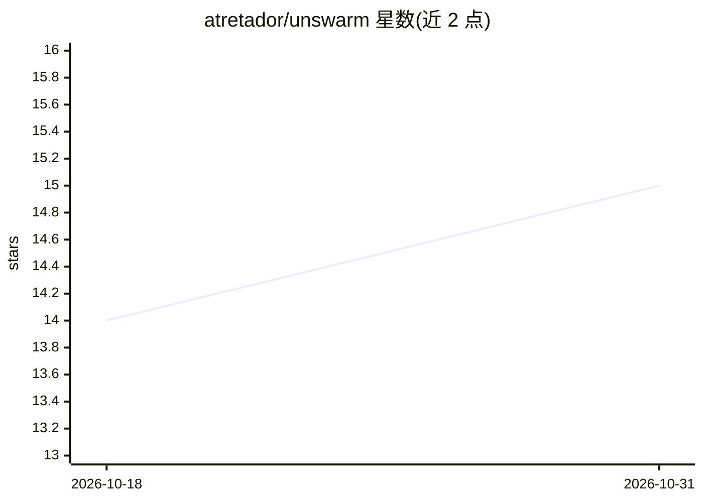

# atretador/unswarm

⭐ 15 · C# · MIT · 推送 2026-10-08 · [GitHub](https://github.com/atretador/unswarm) · [官网](https://unswarm.dev/) · 个人维护

**自托管 LLM 推理基础设施控制平面：多机调度与统一 API 网关**

面向需要在多台机器上管理 LLM 推理的开发者：注册远程 agent，编排运行 llama.cpp/vLLM 等推理服务器的 Docker 容器，通过单一 OpenAI 兼容 /v1/chat/completions 端点路由请求。调度器按需加载/卸载模型容器，以受限 VRAM 服务多个模型；支持独占/共存模型组、会话亲和（防止工具调用间切换抖动）、推理队列、基准测试、遥测监控、用量分析与成本追踪，并可注册 OpenAI/OpenRouter 等云端提供商并定义回退路由。后端为 .NET 10 + SQLite，agent 为 Go，前端 React 19；从源码构建运行，需要 .NET 10 SDK、Go、Node.js 与 Docker。文档明示其适用于多模型低并发场景而非单模型高吞吐服务。

## 筛选速览

| 维度 | 判定 | 备注 |
|---|---|---|
| AI 角色 | `ai-ecosystem` | LLM/agent 周边工具 |
| 许可风险 | `permissive` | MIT |
| 部署形态 | `self-host` | docker 或自建部署 |
| 模型依赖 | local-ok | 支持本地模型 |
| 硬件要求 | — | 无带数字的原话,不猜 |
| 安装摩擦 | `low` | 无编译、无系统依赖或容器化 |
| 成熟度 | — | 结构信号不足 |

## 能力要点

- 按需加载/卸载模型容器，单一 OpenAI 兼容端点服务多模型
- 独占/共存模型组与会话亲和调度，防止工具调用间切换抖动
- 遥测监控、延迟分位/用量分析与三模式成本追踪及预算
- 可注册云端提供商并定义有序回退 Router Profile

## 适用场景

- 把多台机器上的本地模型容器纳管为一个统一 API 端点
- 在有限 VRAM 内为多 agent 工作流提供多个模型
- 本地优先、失败回退云端的模型级联路由

## 场景标签

`模型网关` · 领域:Agent 开发

## 证据(README 行号)

> L7: A self-hosted control plane for managing LLM inference infrastructure across multiple machines. Unswarm lets you reg
> L96: - **OpenAI-Compatible Proxy** — Backend exposes `/v1/chat/completions` that routes requests to the correct agent an
> L97: - **Automatic Model Switching** — Scheduler loads and unloads models on demand, letting you serve many models from 

## 星数曲线

2026-10-18 14 → 2026-10-31 15（+1）

---
*卡片 v1 · prompt 1.4 · 生成 2026-10-31 · 置信度 mid · 依据 README sha `60194ea622bb` · [字段定义](../../DATASET.md)*
