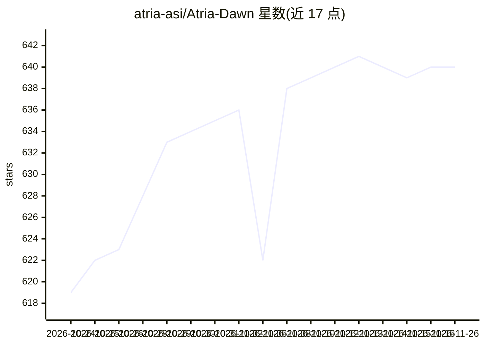

# atria-asi/Atria-Dawn

⭐ 640 · MIT · 推送 2026-10-23 · [GitHub](https://github.com/atria-asi/Atria-Dawn) · [官网](https://atria-asi.ai/) · 组织维护 · 中文 README

**面向科研与工程场景的 744B MoE agentic 大模型**

上海人工智能实验室发布的 agentic 模型，基于 744B 参数 MoE GLM-5.2 底座，上下文 256K/512K，提供 FP8 量化版本。定位科研自动化与办公等生产力场景，覆盖检索发现、软件/ML 构建、文档交付与网络安全四个维度，支持问题分析、工具调用、实验执行到失败恢复的闭环。提供 Hugging Face/ModelScope 权重下载、在线 API 与 SGLang/vLLM 本地部署，给出 Codex/Claude Code/Kimi Code 接入配置。仅接受文本输入。

## 筛选速览

| 维度 | 判定 | 备注 |
|---|---|---|
| AI 角色 | `ai-native` | 本体是模型或模型工具 |
| 许可风险 | `permissive` | MIT |
| 部署形态 | `None` |  |
| 模型依赖 | local-ok | 支持本地模型 |
| 硬件要求 | — | 无带数字的原话,不猜 |
| 安装摩擦 | `low` | 无编译、无系统依赖或容器化 |
| 成熟度 | — | 结构信号不足 |

## 能力要点

- 基于 GLM-5.2 的 744B MoE 架构，512K 上下文，提供 FP8 量化版本
- 覆盖检索、构建、交付、网络安全四类 agentic 任务
- 支持 SGLang/vLLM 本地部署与 OpenAI/Anthropic 兼容 API
- 提供 Codex、Claude Code、Kimi Code 的接入配置方法

## 适用场景

- 把研究问题转化为可执行的实验方案并完成实验闭环
- 构建软件应用、数据可视化与机器学习系统
- 将文档与设计需求转为报告、演示等交付物
- 在授权环境下做漏洞验证与修复复检

## 场景标签

`编码 Agent` `科研工具` `网络安全` · 领域:编码与开发

## 证据(README 行号)

> L47: **Atria Dawn** is a new-generation agentic model developed by the **Shanghai Artificial Intelligence Laboratory**. 
> L107: Atria Dawn supports both local deployment and hosted access.
> L64: |**Atria Dawn**|Instruct model (full release)|512K|🤗 Model|🔗 Model|

## 星数曲线

2026-10-24 619 → 2026-11-26 640（+21）

---
*卡片 v1 · prompt 1.4 · 生成 2026-11-24 · 置信度 high · 依据 README sha `3b3f6ffff4c0` · [字段定义](../../DATASET.md)*
