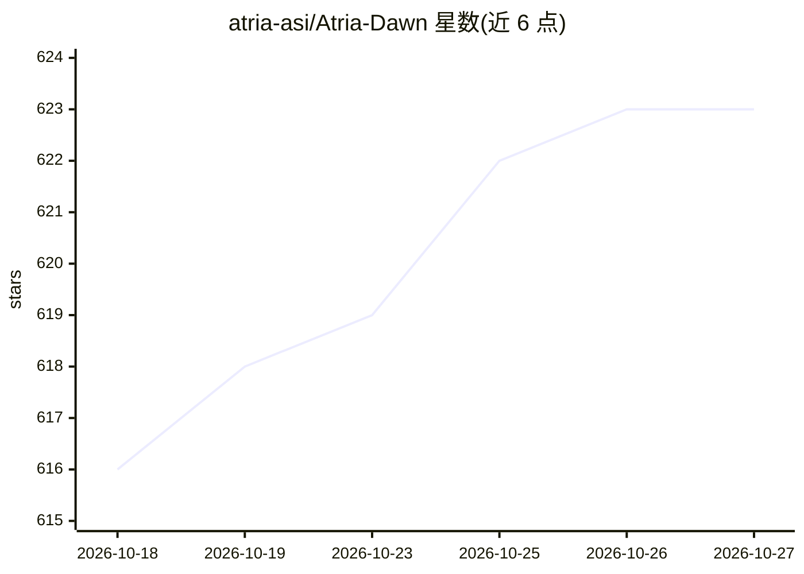

# atria-asi/Atria-Dawn

⭐ 623 · MIT · 推送 2026-10-23 · [GitHub](https://github.com/atria-asi/Atria-Dawn) · [官网](https://atria-asi.ai/) · 组织维护 · 中文 README

**面向科研与工程场景的 agentic 大模型（744B MoE）**

上海人工智能实验室发布的 agentic 模型 Atria Dawn，基于 744B 参数 MoE GLM-5.2 基座，面向需要持续环境理解、工具调用与多步骤任务完成的研究与工程场景，覆盖发现、创作、交付、网络安全四个维度。提供 Preview 版与 FP8 量化版权重（256K 上下文，全量版 512K 标注 Coming soon），支持 SGLang/vLLM 本地部署与 API 在线访问，README 给出 Codex、Claude Code、Kimi Code 三种编码客户端的接入配置；模型仅接受文本输入。代码与权重以 MIT 许可发布。

## 筛选速览

| 维度 | 判定 | 备注 |
|---|---|---|
| AI 角色 | `ai-native` | 本体是模型或模型工具 |
| 许可风险 | `permissive` | MIT |
| 部署形态 | `None` |  |
| 模型依赖 | local-ok | 支持本地模型 |
| 硬件要求 | — | 无带数字的原话,不猜 |
| 安装摩擦 | `low` | 无编译、无系统依赖或容器化 |
| 成熟度 | `idea` | |

## 能力要点

- 基于 744B MoE GLM-5.2 基座的 agentic 模型
- Preview 版 256K 上下文，提供 FP8 量化版本
- 支持 SGLang（v0.5.13.post1+）与 vLLM（v0.23.0+）本地部署
- README 提供 Codex / Claude Code / Kimi Code 客户端接入配置，模型仅接受文本输入

## 适用场景

- 通过 API 或本地部署运行科研自动化、办公生产力的 agent 任务
- 在编码客户端（Codex/Claude Code/Kimi Code）中作为后端模型使用
- 执行安全漏洞分析与验证等网络安全任务

## 场景标签

`编码 Agent` `网络安全` `科研工具` · 领域:编码与开发

## 证据(README 行号)

> L47: **Atria Dawn** is a new-generation agentic model developed by the **Shanghai Artificial Intelligence Laboratory**. 
> L51: Atria Dawn empowers agentic tasks across four dimensions, with a particular focus on end-to-end delivery in real-wo

## 星数曲线

2026-10-18 616 → 2026-10-27 623（+7）

---
*卡片 v1 · prompt 1.4 · 生成 2026-10-21 · 置信度 high · 依据 README sha `24be93687e8d` · [字段定义](../../DATASET.md)*
