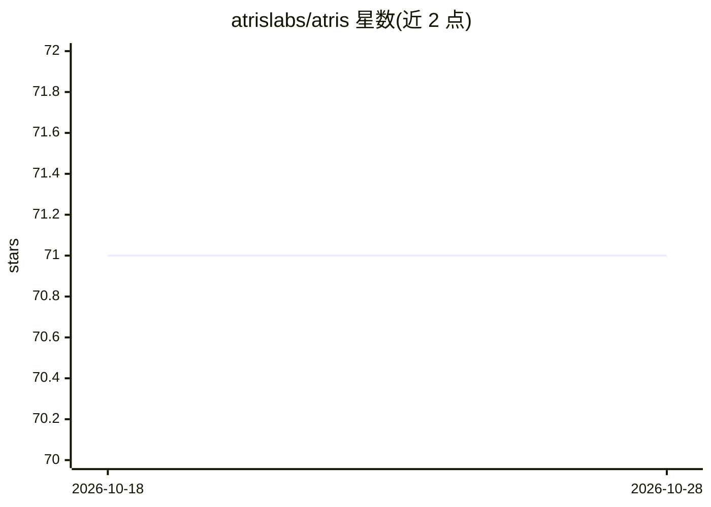

# atrislabs/atris

⭐ 71 · JavaScript · 推送 2026-10-28 · [GitHub](https://github.com/atrislabs/atris) · [官网](https://atris.ai) · 组织维护

**把任意仓库变成 AI agent 可操作工作区的 CLI 与 MCP 服务**

面向开发者和团队的命令行工具：在仓库中脚手架生成 atris 工作区，为 agent 提供共享上下文（atris.md、wiki、日志、任务）、plan-do-review 循环、持久化任务与验证机制，使工作以实际检查命令通过为完成标准。支持多成员（member）并行执行任务、自落地开关（推送分支并开 PR）、agent 独立登录客户端、业务共享 owner 工作区、静态站点发布及 AgentXP 游戏化循环。要求 Node.js 18+（atris task 需 22+），云端功能需 atris setup 接入 hosted Atris cloud。

## 筛选速览

| 维度 | 判定 | 备注 |
|---|---|---|
| AI 角色 | `ai-ecosystem` | LLM/agent 周边工具 |
| 许可风险 | `none` | — |
| 部署形态 | `library` | 以包/库形式分发 |
| 模型依赖 | — | README 未给出锁定关系 |
| 硬件要求 | — | 无带数字的原话,不猜 |
| 安装摩擦 | `low` | 无编译、无系统依赖或容器化 |
| 成熟度 | — | 结构信号不足 |

## 能力要点

- plan -> do -> review 循环，工作以必须通过的检查命令收尾
- 多成员并行执行任务，双重审查且执行与审查分离
- agent-client 独立登录，token 自动续期
- atris recap 生成有凭据的工作摘要

## 适用场景

- 让 coding agent 在结构化工作区中带上下文地完成仓库任务
- 并行派出多个 agent 成员各领一个可验证任务
- 为团队或公司建立共享的 AI 工作区与操作审计

## 场景标签

`编码 Agent` `多智能体` · 领域:Agent 开发

## 证据(README 行号)

> L5: Under the hood it is an operating system for AI work. It turns any repo into a workspace an agent can actually opera
> L93: Integrates with any agent.

## 星数曲线

2026-10-18 71 → 2026-10-28 71（+0）

---
*卡片 v1 · prompt 1.4 · 生成 2026-10-24 · 置信度 mid · 依据 README sha `191542f8c801` · [字段定义](../../DATASET.md)*
