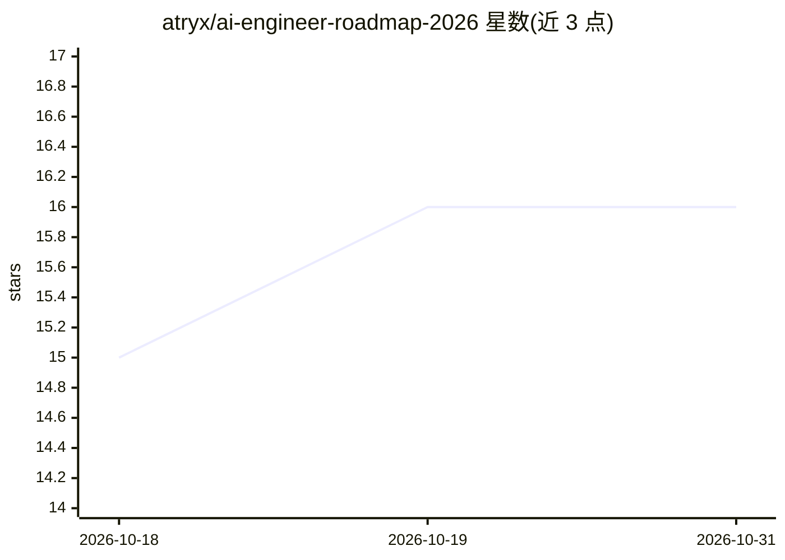

# atryx/ai-engineer-roadmap-2026

⭐ 16 · MIT · 推送 2026-04-15 · [GitHub](https://github.com/atryx/ai-engineer-roadmap-2026) · 个人维护

**2026 年 AI 工程师学习路线图：LLM/RAG/Agent/微调/评测分阶段清单**

面向想成为生产级 AI 工程师的开发者的结构化学习路线：区分 AI 工程师与 ML 工程师、数据科学家的角色边界，按 9 个阶段组织学习内容——Python 与数学基础、LLM 概念与 API、提示工程、RAG 管线与向量数据库、Agent 框架与 MCP、微调方法（LoRA/QLoRA）、评测、生产系统（流式/缓存/护栏/成本控制）、多模态。各阶段标注建议时长，以复选框清单、对比表格和少量 Python 代码片段呈现。声明关注应用构建而非模型研究。

## 筛选速览

| 维度 | 判定 | 备注 |
|---|---|---|
| AI 角色 | `ai-knowledge` | 知识聚合/清单类 |
| 许可风险 | `permissive` | MIT |
| 部署形态 | `None` |  |
| 模型依赖 | — | README 未给出锁定关系 |
| 硬件要求 | — | 无带数字的原话,不猜 |
| 安装摩擦 | `low` | 无编译、无系统依赖或容器化 |
| 成熟度 | — | 结构信号不足 |

## 能力要点

- 9 个阶段覆盖基础到生产系统与多模态，每阶段附建议学习时长
- 模型/向量库/框架/评测/护栏工具的对比表格与选型清单
- 覆盖 MCP、Agentic RAG、LLM-as-Judge 等主题条目

## 适用场景

- 按阶段自学成为构建 LLM 应用的 AI 工程师
- 查找 RAG、Agent、微调、评测各环节的工具清单
- 规划从基础到生产部署的 AI 工程学习路径

## 场景标签

`教程课程` · 领域:学习与行业

## 证据(README 行号)

> L7: A structured path to becoming a production AI engineer in 2026. Not ML research — **building, deploying, and operati
> L21: This roadmap is for **AI Engineers** — you build products on top of models, not train them from scratch.

## 星数曲线

2026-10-18 15 → 2026-10-31 16（+1）

---
*卡片 v1 · prompt 1.4 · 生成 2026-10-30 · 置信度 high · 依据 README sha `be960e0e2cbf` · [字段定义](../../DATASET.md)*
