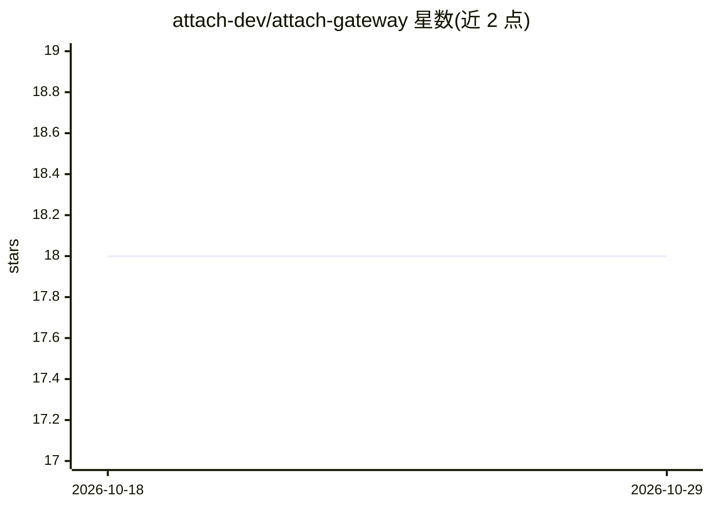

# attach-dev/attach-gateway

⭐ 18 · Python · MIT · 推送 2026-01-17 · [GitHub](https://github.com/attach-dev/attach-gateway) · [官网](http://attach.dev) · 组织维护

**为本地 LLM 服务器与 agent 框架提供认证与记忆的网关 side-car**

面向 Ollama、vLLM 等本地模型服务器的身份与记忆代理网关：验证 OIDC/JWT 或 DID-JWT 令牌，向下游注入 X-Attach-User/X-Attach-Session 身份头，实现 Google A2A 与 OpenHands 的 /tasks/send、/tasks/status 接口，并将提示与响应镜像到可插拔记忆后端（默认 Weaviate Docker 容器）。另提供 Temporal 工作流追踪、按用户 token 配额（可选 tiktoken）、Prometheus/OpenMeter 用量计量。通过 PyPI 安装或源码运行，配额的内存计数器不跨进程共享，生产需 Redis。

## 筛选速览

| 维度 | 判定 | 备注 |
|---|---|---|
| AI 角色 | `ai-ecosystem` | LLM/agent 周边工具 |
| 许可风险 | `permissive` | MIT |
| 部署形态 | `library` | 以包/库形式分发 |
| 模型依赖 | local-ok | 支持本地模型 |
| 硬件要求 | — | 无带数字的原话,不猜 |
| 安装摩擦 | `low` | 无编译、无系统依赖或容器化 |
| 成熟度 | — | 结构信号不足 |

## 能力要点

- OIDC/JWT 与 DID-JWT（did:key、did:pkh）令牌验证
- 实现 Google A2A /tasks/send + /tasks/status 交接端点
- 提示与响应镜像到可插拔记忆后端（默认 Weaviate）
- 按用户 token 配额与 Prometheus/OpenMeter 用量计量

## 适用场景

- 为本地 Ollama/vLLM 服务器添加认证层
- 多 agent 间以统一身份头进行 A2A 交接
- 记录并共享 agent 会话上下文到向量记忆库

## 场景标签

`模型网关` `Agent 记忆` · 领域:Agent 开发

## 证据(README 行号)

> L3: > **Identity & Memory side‑car** for every LLM engine and multi‑agent framework. Add OIDC / DID SSO, A2A hand‑off, a
> L9: LLM engines such as **Ollama** or **vLLM** ship with **zero auth**. Agent‑to‑agent protocols (Google **A2A**, MCP, O

## 星数曲线

2026-10-18 18 → 2026-10-29 18（+0）

---
*卡片 v1 · prompt 1.4 · 生成 2026-10-29 · 置信度 high · 依据 README sha `ec409cfb9868` · [字段定义](../../DATASET.md)*
