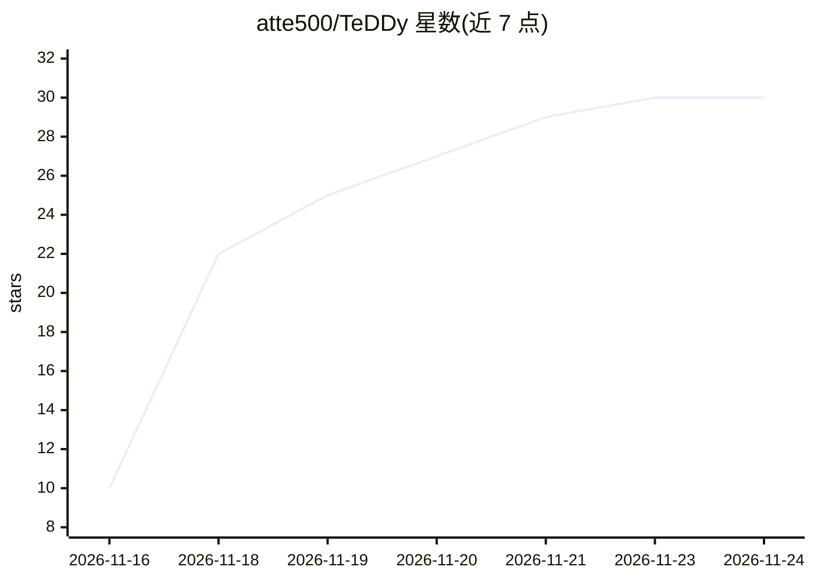

# atte500/TeDDy

⭐ 30 · Python · AGPL-3.0 · 推送 2026-11-23 · [GitHub](https://github.com/atte500/TeDDy) · [官网](https://pypi.org/project/teddy-cli) · 个人维护

**本地优先的软件工程 agent 编排框架，将 TDD 流程嵌入 AI 开发工作流**

面向开发者的本地优先编码 agent harness：以纯 Markdown 文档为接口，将测试驱动开发、六边形架构、迭代增量交付等工程实践嵌入 agent 工作流。内置 Pathfinder/Architect/Prototyper/Developer/Debugger/Assistant 等专职 agent，按阶段化结构化提示词组织软件交付生命周期；本地纯文本存储、无云端依赖与遥测，会话保留不可变历史可审计。通过 PyPI（uv tool install teddy-cli）安装，需 Python 3.11+，附带 TUI；提供专业咨询服务。实验版预发布可能包含破坏性变更。

## 筛选速览

| 维度 | 判定 | 备注 |
|---|---|---|
| AI 角色 | `ai-ecosystem` | LLM/agent 周边工具 |
| 许可风险 | `viral` | AGPL-3.0 |
| 部署形态 | `library` | 以包/库形式分发 |
| 模型依赖 | local-ok | 支持本地模型 |
| 硬件要求 | — | 无带数字的原话,不猜 |
| 安装摩擦 | `low` | 无编译、无系统依赖或容器化 |
| 成熟度 | `idea` | |

## 能力要点

- Markdown 文档作为 SDLC 各阶段的接口与人在环媒介
- 六个专职 agent 按结构化阶段组织交付流程
- 本地优先：无云端依赖、无专有数据库、无后台遥测
- agent 提示词、模板、治理规则均可通过纯文本定制

## 适用场景

- 用 TDD 与小步提交流程驱动 AI agent 写代码
- 在本地工作区中编排多 agent 完成从规划到交付的完整流程
- 审计 agent 意图与实际执行的历史记录

## 场景标签

`多智能体` `编码 Agent` `Agent 框架` · 领域:Agent 开发

## 证据(README 行号)

> L21: TeDDy addresses them instead by embedding proven engineering practices like **Test-Driven Development, Hexagonal Ar
> L47: 1. **Markdown as the interface.** Inspired by Obsidian, living documents such as specs, architecture contracts, and
> L83: - **Agent Prompts (`.teddy/prompts/`):** To change the process itself, customize the agent prompts. Each agent's wo

## 星数曲线

2026-11-16 10 → 2026-11-24 30（+20）

---
*卡片 v1 · prompt 1.4 · 生成 2026-11-18 · 置信度 mid · 依据 README sha `dfee0fcda8d1` · [字段定义](../../DATASET.md)*
