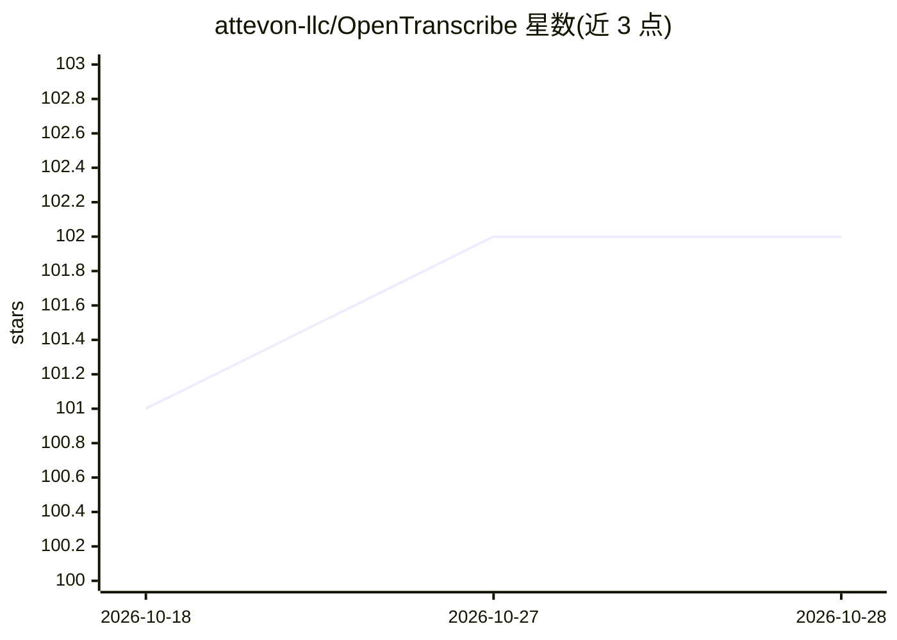

# attevon-llc/OpenTranscribe

⭐ 102 · Python · AGPL-3.0 · 推送 2026-10-28 · [GitHub](https://github.com/attevon-llc/OpenTranscribe) · [官网](http://docs.opentranscribe.app) · 组织维护

**自托管 AI 转录平台：语音转文字、说话人分离与全文检索**

基于 Svelte + FastAPI 的容器化 Web 应用，面向需要自托管媒体转录的团队：用 WhisperX（faster-whisper 后端，默认 large-v3-turbo）做 100+ 语言的语音转写，PyAnnote v4 做说话人分离与跨视频声纹识别，OpenSearch 提供关键词+语义混合检索，并支持针对转写文本的 RAG 对话（BM25+kNN 融合检索、引用定位到播放时刻）。支持本地/S3/SMB 目录自动导入、yt-dlp 处理 1800+ 平台 URL、SRT/VTT 字幕导出。限制：无 AI 提供商时仅聊天功能不可用（转写、分离、检索均本地模型运行）；默认分支处于活跃开发，稳定部署需安装发布版。

## 筛选速览

| 维度 | 判定 | 备注 |
|---|---|---|
| AI 角色 | `ai-native` | 本体是模型或模型工具 |
| 许可风险 | `viral` | AGPL-3.0 |
| 部署形态 | `self-host` | docker 或自建部署 |
| 模型依赖 | local-ok | 支持本地模型 |
| 硬件要求 | — | 无带数字的原话,不猜 |
| 安装摩擦 | `low` | 无编译、无系统依赖或容器化 |
| 成熟度 | `idea` | |

## 能力要点

- WhisperX + large-v3-turbo 转写，词级时间戳，GPU 批处理约 40x 实时速度
- PyAnnote v4 说话人分离、声纹跨视频匹配与全局说话人档案
- OpenSearch 混合检索（关键词+神经向量）
- 基于转写文本的 RAG 聊天，带编号引用与说话人范围过滤；无提供商时可用 mock LLM

## 适用场景

- 上传音视频文件生成带说话人标注的转写与 SRT/VTT 字幕
- 会议、访谈录音库的全文与语义搜索
- 对自己录制的转写内容提问并定位到原始音视频时刻
- 监控本地/S3/SMB 目录自动导入并转录新媒体

## 场景标签

`语音识别` `语义搜索` `RAG` · 领域:知识与检索

## 证据(README 行号)

> L27: - **High-Accuracy Speech Recognition**: Powered by WhisperX with faster-whisper backend
> L40: - **Automatic Speaker Diarization**: Identify different speakers using PyAnnote v4 with enhanced accuracy

## 星数曲线

2026-10-18 101 → 2026-10-28 102（+1）

---
*卡片 v1 · prompt 1.4 · 生成 2026-10-23 · 置信度 high · 依据 README sha `4408f35b40d9` · [字段定义](../../DATASET.md)*
