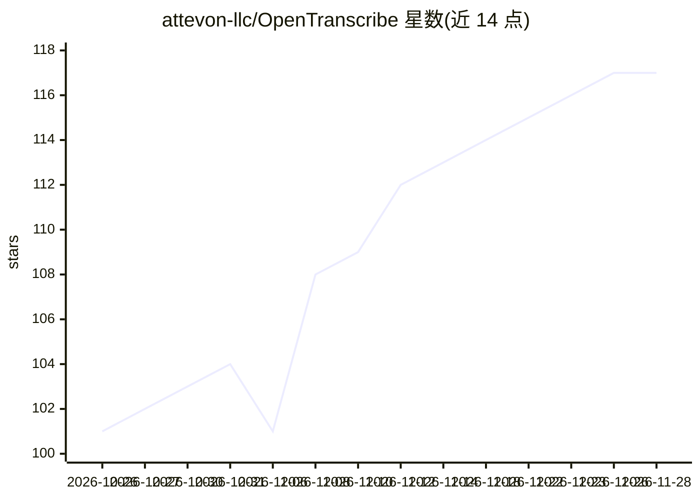

# attevon-llc/OpenTranscribe

⭐ 117 · Python · AGPL-3.0 · 推送 2026-11-22 · [GitHub](https://github.com/attevon-llc/OpenTranscribe) · [官网](http://docs.opentranscribe.app) · 组织维护

**自托管音视频转写平台，提供说话人分离、检索与协作**

容器化的自托管 Web 应用，上传音视频后执行语音转文字、说话人分离与跨视频声纹识别，并生成 AI 标签与集合；基于转写内容提供带时间点引用的 RAG 问答。转写采用 WhisperX（faster-whisper 后端），默认 diar-native 引擎、PyAnnote v4 兜底。支持 Watch Sources 自动导入（本地/S3/SMB）、混合检索、SRT/DOCX/PDF 导出与浏览器内录音。一行 Docker 安装器部署到指定 release；GPU 可加速，CPU 亦可运行。

## 筛选速览

| 维度 | 判定 | 备注 |
|---|---|---|
| AI 角色 | `ai-native` | 本体是模型或模型工具 |
| 许可风险 | `viral` | AGPL-3.0 |
| 部署形态 | `self-host` | docker 或自建部署 |
| 模型依赖 | — | README 未给出锁定关系 |
| 硬件要求 | `cpu-ok` | |
| 安装摩擦 | `low` | 无编译、无系统依赖或容器化 |
| 成熟度 | `idea` | |

## 能力要点

- WhisperX/faster-whisper 转写，100+ 语言与词级时间戳
- 本地说话人分离引擎与跨视频声纹识别
- 转写内容上的 RAG 问答，流式输出并带可跳转引用
- Watch Sources：本地/S3/SMB 自动导入与三层去重

## 适用场景

- 会议录音批量转写并自动区分说话人
- 对媒体库提问，AI 依据转写内容回答并定位到原片段
- 监听文件夹/S3 桶自动导入并转写新录音
- 导出 SRT 字幕或可引用行号的 DOCX/PDF 文档

## 场景标签

`RAG` `语音识别` · 领域:知识与检索

## 证据(README 行号)

> L10: OpenTranscribe is a powerful, containerized web application for transcribing and analyzing audio/video files using 
> L27: - **High-Accuracy Speech Recognition**: Powered by WhisperX with faster-whisper backend
> L40: - **Automatic Speaker Diarization**: Identify different speakers with the native diarization engine (the diar-nativ

## 星数曲线

2026-10-26 101 → 2026-11-28 117（+16）

---
*卡片 v1 · prompt 1.4 · 生成 2026-11-28 · 置信度 high · 依据 README sha `e6a49fd741c9` · [字段定义](../../DATASET.md)*
