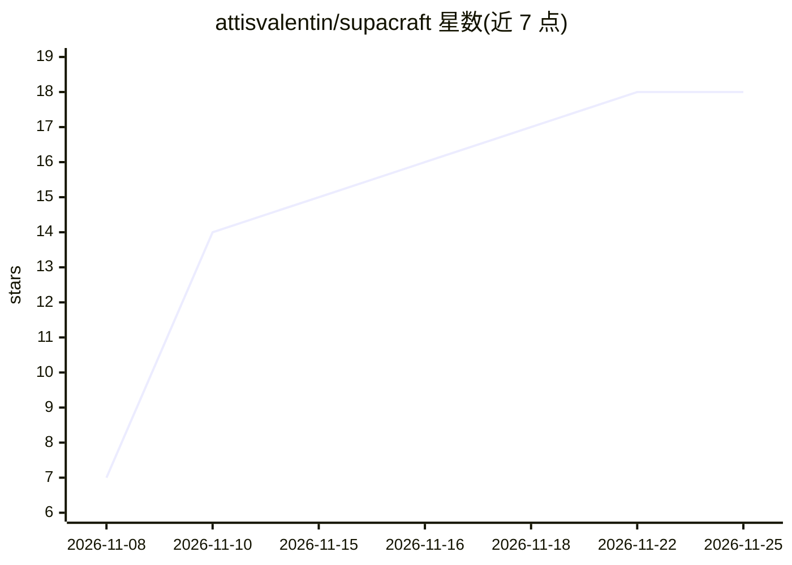

# attisvalentin/supacraft

⭐ 18 · Go · MIT · 推送 2026-11-19 · [GitHub](https://github.com/attisvalentin/supacraft) · 个人维护

**单二进制声明式后端：AI Agent 经 MCP 生成 supacraft.json 并运行 REST API**

用 Go 编写的开源后端：整个后端（SQLite 数据库、JWT 认证、OAuth 登录、自定义端点、cron/后台任务、webhook、realtime WebSocket、文件存储、邮件）声明在一个 supacraft.json 文件中，由单个二进制运行。内置 MCP 服务器，Claude Code、Cursor 等 MCP 客户端可用自然语言让 Agent 生成和修改该文件，每次变更先验证再保存；也可手工编辑 JSON 并用 supacraft dev 运行。支持单服务器多租户部署，一个 serve 进程托管多个 API。面向快速 MVP、原型与内部工具开发者。

## 筛选速览

| 维度 | 判定 | 备注 |
|---|---|---|
| AI 角色 | `ai-enhanced` | 去掉 AI 部分产品仍成立 |
| 许可风险 | `permissive` | MIT |
| 部署形态 | `library` | 以包/库形式分发 |
| 模型依赖 | — | README 未给出锁定关系 |
| 硬件要求 | — | 无带数字的原话,不猜 |
| 安装摩擦 | `low` | 无编译、无系统依赖或容器化 |
| 成熟度 | — | 结构信号不足 |

## 能力要点

- 整个后端（表、权限、端点、cron）声明在一个 supacraft.json 文件中
- 内置 MCP 服务器，Agent 可构建、测试、部署项目，危险操作需用户批准
- 单二进制运行，SQLite 存储，无需 Docker、云账号或独立数据库
- 单服务器多租户：supacraft deploy 秒级上线新 API，X-Tenant-ID 路由

## 适用场景

- 用自然语言让 AI Agent 快速搭建一个带认证与数据库的 MVP 后端
- 在自有服务器上以声明式 JSON 管理多个项目的 API，替代托管后端平台
- 在 git 仓库中以可 diff 的 JSON 维护后端定义并跑请求级测试

## 场景标签

 · 领域:后端开发/低代码

## 证据(README 行号)

> L25: 2. **An AI agent writes that file for you.** SupaCraft ships an MCP

## 星数曲线

2026-11-08 7 → 2026-11-25 18（+11）

---
*卡片 v1 · prompt 1.4 · 生成 2026-11-18 · 置信度 mid · 依据 README sha `9e25765eb8af` · [字段定义](../../DATASET.md)*
