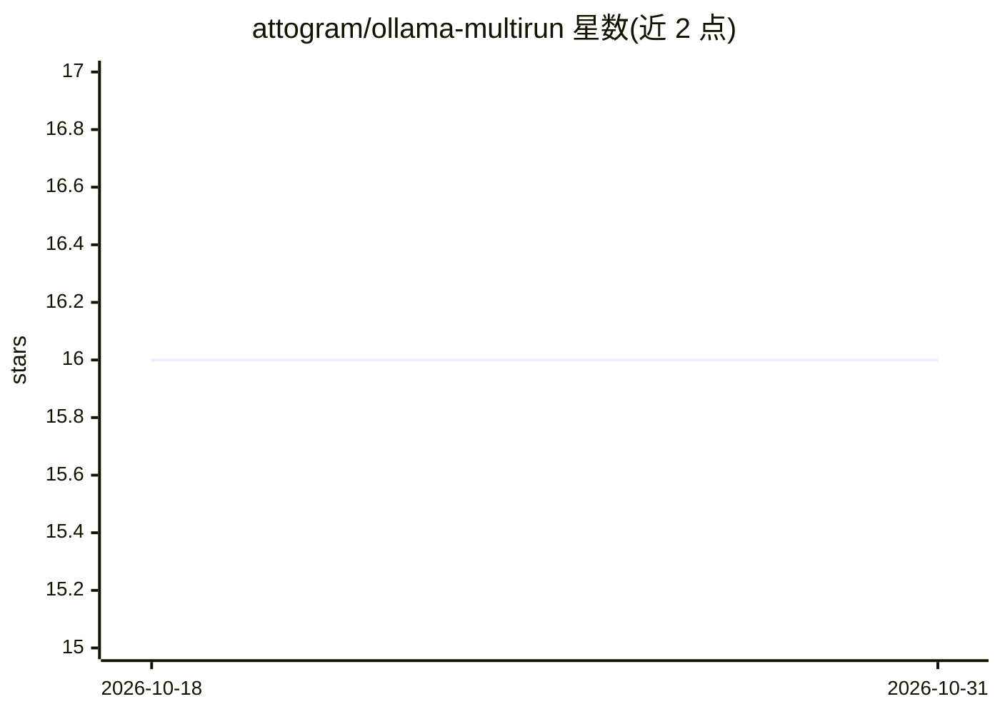

# attogram/ollama-multirun

⭐ 16 · Shell · MIT · 推送 2026-07-12 · [GitHub](https://github.com/attogram/ollama-multirun) · [官网](https://attogram.github.io/ai_test_zone/ollama-multirun) · 个人维护

**Bash 脚本：对 Ollama 本地模型批量跑同一 prompt 并生成报告**

单一 Bash 脚本工具：将一个 prompt 依次提交给本机 Ollama 上全部或指定模型（读取 `ollama list`），每次运行前清理并停止已加载模型以保证结果一致。捕获 `ollama --verbose` 的总时长、加载时长、prompt/生成评估计数与速率等统计，输出带索引页与各模型页的静态 HTML 报告；prompt 以纯文本与 GitHub prompt YAML 格式保存。运行需 bash（≥3.2）、Ollama 与 expect。适合本地多模型对比实验与记录。

## 筛选速览

| 维度 | 判定 | 备注 |
|---|---|---|
| AI 角色 | `ai-ecosystem` | LLM/agent 周边工具 |
| 许可风险 | `permissive` | MIT |
| 部署形态 | `None` |  |
| 模型依赖 | local-ok | 支持本地模型 |
| 硬件要求 | — | 无带数字的原话,不猜 |
| 安装摩擦 | `low` | 无编译、无系统依赖或容器化 |
| 成熟度 | — | 结构信号不足 |

## 能力要点

- 同一 prompt 批量跑 Ollama 全部或指定模型
- 生成含索引页、各模型输出页的静态 HTML 报告
- 捕获 ollama --verbose 性能统计（时长/评估速率等）
- prompt 以 prompt.txt 与 .prompt.yaml 格式留存，运行前清空模型

## 适用场景

- 比较多个本地模型对同一 prompt 的回答
- 记录并跟踪本地模型实验的性能数据
- 为模型对比结果生成可浏览的网页报告

## 场景标签

`模型评测` · 领域:评测与运维

## 证据(README 行号)

> L5: A bash shell script to run a single prompt against any or all of your locally installed ollama models,
> L40: * **Batch Processing:** Run a single prompt across all models listed by `ollama list`.

## 星数曲线

2026-10-18 16 → 2026-10-31 16（+0）

---
*卡片 v1 · prompt 1.4 · 生成 2026-10-30 · 置信度 high · 依据 README sha `f0840cffbd82` · [字段定义](../../DATASET.md)*
