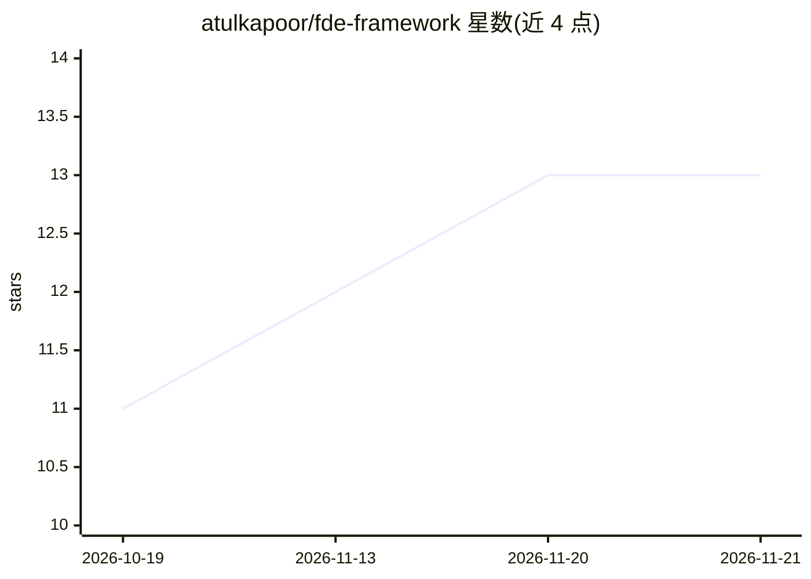

# atulkapoor/fde-framework

⭐ 13 · Python · Apache-2.0 · 推送 2026-10-21 · [GitHub](https://github.com/atulkapoor/fde-framework) · [官网](https://atulkapoor.github.io/fde-framework/) · 个人维护

**给前置部署工程师的 AI 项目决策框架：证据不足即拒绝开工**

面向前置部署工程师的开源 Python 框架：从问题陈述出发，经结构化需求发现、带引用的决策引擎和八项前置门禁检查，生成可部署的 AI 项目（含部署包、评估 harness、runbook），支持本地/VPC/完全气隙环境。决策路径不调用 LLM，构建确定性可复现；证据不足或无基线时拒绝构建。同一命令集以 MCP server 形式供 Claude Code/Cursor 等编码 agent 调用，也提供适配多 agent 的 skill。

## 筛选速览

| 维度 | 判定 | 备注 |
|---|---|---|
| AI 角色 | `ai-ecosystem` | LLM/agent 周边工具 |
| 许可风险 | `permissive` | Apache-2.0 |
| 部署形态 | `library` | 以包/库形式分发 |
| 模型依赖 | — | README 未给出锁定关系 |
| 硬件要求 | — | 无带数字的原话,不猜 |
| 安装摩擦 | `low` | 无编译、无系统依赖或容器化 |
| 成熟度 | — | 结构信号不足 |

## 能力要点

- 八项前置门禁检查与拒绝构建机制，豁免写入 RISKS.md
- 决策路径不调用 LLM，同输入产出字节一致的项目
- MCP server 供编码 agent 调用，带 JSON Schema 契约与版本化
- 支持 on-premise、客户 VPC 与完全气隙部署场景

## 适用场景

- 客户现场接单前评估该 AI 系统是否该建、怎么建
- 在受监管或气隙环境中交付 LLM 系统
- 让编码 agent 在动手前先做需求 triage 与可行性判定
- 咨询团队沉淀可复用的交付案例语料

## 场景标签

`代码生成` `模型评测` · 领域:编码与开发

## 证据(README 行号)

> L24: **fde** is an open-source framework for Forward Deployed Engineers: it takes a
> L34: structured discovery and requirements intake, a decision engine that cites its
> L92: **Inside your coding agent.** The same commands are an MCP server, so an

## 星数曲线

2026-10-19 11 → 2026-11-21 13（+2）

---
*卡片 v1 · prompt 1.4 · 生成 2026-11-18 · 置信度 mid · 依据 README sha `d7eeaee8bb4a` · [字段定义](../../DATASET.md)*
