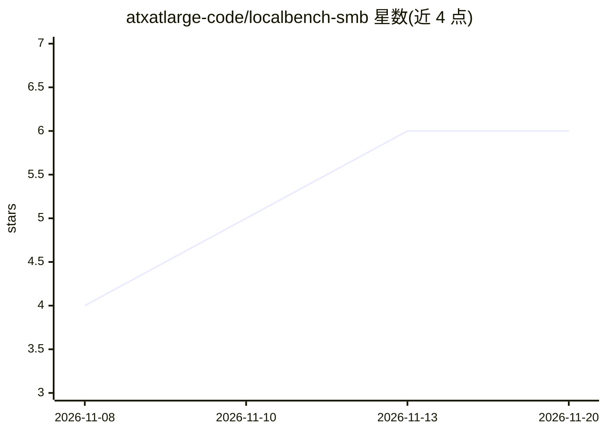

# atxatlarge-code/localbench-smb

⭐ 6 · Python · MIT · 推送 2026-11-14 · [GitHub](https://github.com/atxatlarge-code/localbench-smb) · 个人维护

**面向 SMB 的本地 LLM 业务工作流基准：9 类任务 180 个确定性用例**

LocalBench SMB v2.0 是一个本地小模型评测基准：针对 9 类日常业务工作流（邮件分诊、商务写作、文档问答、语音指令、团队聊天、数据过滤、账务公式、流程自动化、任务路由）提供 180 个确定性测试用例（90 公开 + 90 私有保留集），采用纯程序化验证（无 LLM-as-a-judge）。支持 Ollama、MLX、LiteRT、vLLM 等运行时，绑定 127.0.0.1 零外发；参考硬件为 Apple Silicon Mac。零外部 Python 依赖（仅标准库），另提供各工作流的实现蓝图与评分规范文档。

## 筛选速览

| 维度 | 判定 | 备注 |
|---|---|---|
| AI 角色 | `ai-ecosystem` | LLM/agent 周边工具 |
| 许可风险 | `permissive` | MIT |
| 部署形态 | `None` |  |
| 模型依赖 | local-ok | 支持本地模型 |
| 硬件要求 | — | 无带数字的原话,不猜 |
| 安装摩擦 | `low` | 无编译、无系统依赖或容器化 |
| 成熟度 | — | 结构信号不足 |

## 能力要点

- 9 类业务工作流 × 180 个确定性用例，程序化评分（无 LLM-as-a-judge）
- 支持 Ollama/MLX/LiteRT/vLLM 等本地运行时，127.0.0.1 绑定零外发
- 含 specialist_router.py 双模型组合路由与 AST 自愈边界探针
- 零外部依赖，仅需 Python 3 标准库即可运行

## 适用场景

- 在购买云 API 前先测量本地小模型能否覆盖我的业务任务
- 为 Apple Silicon Mac 选型合适的本地运行时与模型组合
- 用公开+私有保留集检验模型是否对测试用例过拟合

## 场景标签

`模型评测` · 领域:评测与运维

## 证据(README 行号)

> L11: **LocalBench SMB v2.0** evaluates compact local models (`0.8B` to `14B`) across **9 everyday business pillars (`180
> L21: > **How Scoring Works:** Every test case uses strict programmatic verification (zero "LLM-as-a-judge"). **Strict Re
> L58: **LocalBench SMB** requires **zero external Python packages** (100% Python 3 standard library) and runs against Oll

## 星数曲线

2026-11-08 4 → 2026-11-20 6（+2）

---
*卡片 v1 · prompt 1.4 · 生成 2026-11-20 · 置信度 high · 依据 README sha `dd9c3bd9a711` · [字段定义](../../DATASET.md)*
