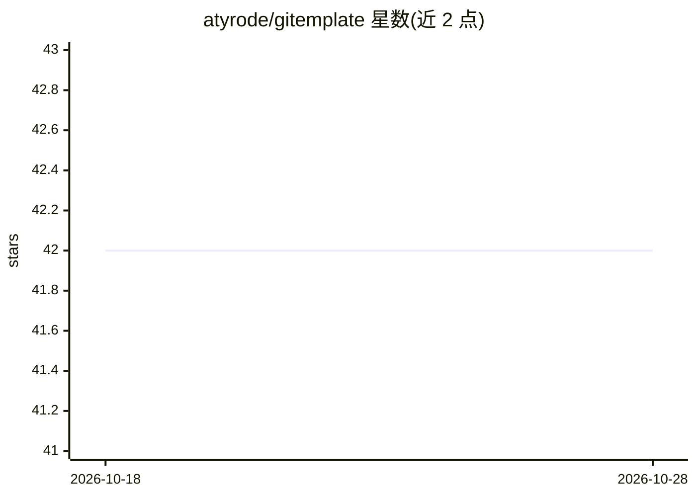

# atyrode/gitemplate

⭐ 42 · Python · MIT · 推送 2026-04-22 · [GitHub](https://github.com/atyrode/gitemplate) · [官网](http://gitemplate.com) · 个人维护

**面向 AI/LLM Web 应用的 FastAPI 项目模板**

一个生产就绪的 FastAPI 项目模板，用于构建 AI/LLM 驱动的 Web 应用：集成 Jinja2 模板与 TailwindCSS 前端，内置速率限制、安全头、CORS、环境变量管理等安全配置，提供 Docker 多阶段构建、GitHub Actions CI/CD、健康检查端点与日志等部署组件，并预配置 black/isort/pylint/mypy/pytest 等开发工具。通过 template.py 定制包名与依赖后生成项目骨架，用 uvicorn 启动开发服务器。面向希望快速搭建 AI 应用后端与 Web 服务的开发者。

## 筛选速览

| 维度 | 判定 | 备注 |
|---|---|---|
| AI 角色 | `ai-ecosystem` | LLM/agent 周边工具 |
| 许可风险 | `permissive` | MIT |
| 部署形态 | `self-host` | docker 或自建部署 |
| 模型依赖 | — | README 未给出锁定关系 |
| 硬件要求 | — | 无带数字的原话,不猜 |
| 安装摩擦 | `low` | 无编译、无系统依赖或容器化 |
| 成熟度 | — | 结构信号不足 |

## 能力要点

- FastAPI + Jinja2 + TailwindCSS 技术栈的模板结构
- 内置速率限制、安全头、CORS、可信主机等安全配置
- Docker 多阶段构建与 GitHub Actions CI/CD 工作流
- 通过 template.py 定制包名、项目名与依赖后生成骨架

## 适用场景

- 快速搭建 AI/LLM 应用的后端与 Web 服务骨架
- 需要预置安全配置与部署流水线的新项目起步
- 按模板结构规范化团队的 FastAPI 项目布局

## 场景标签

 · 领域:Web 开发/项目模板

## 证据(README 行号)

> L9: A production-ready FastAPI template specifically designed for building AI/LLM-powered web applications.
> L11: - 🤖 Optimized for LLM integration and AI workflows

## 星数曲线

2026-10-18 42 → 2026-10-28 42（+0）

---
*卡片 v1 · prompt 1.4 · 生成 2026-10-25 · 置信度 mid · 依据 README sha `722eab708ad2` · [字段定义](../../DATASET.md)*
