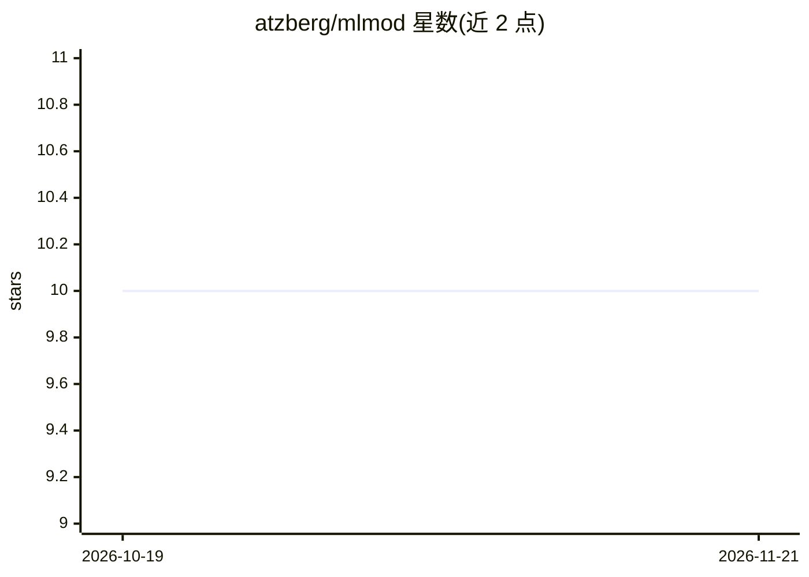

# atzberg/mlmod

⭐ 10 · C++ · NOASSERTION · 推送 2026-04-07 · [GitHub](https://github.com/atzberg/mlmod) · [官网](https://web.atzberger.org) · 组织维护

**给研究者提供在 LAMMPS 分子动力学中嵌入 ML 模型的仿真包**

MLMOD 是 Python/C++ 机器学习仿真包，将数据驱动模型接入 LAMMPS 分子动力学：以 PyTorch 定义模型，经 torch.jit.trace 导出 .pt 后由 C++ 扩展在运行时加载，可替换积分器、计算粒子间力场、流体动力学迁移张量及在轨观测量，支持 MPI 并行。安装提供预编译 wheel、quick_install 脚本、requirements.txt 与 Docker 途径；MPI 示例需 mpi4py 与 MPI 编译版。面向做粒子系统、材料与复杂流体建模的研究者。

## 筛选速览

| 维度 | 判定 | 备注 |
|---|---|---|
| AI 角色 | `ai-native` | 本体是模型或模型工具 |
| 许可风险 | `none` | NOASSERTION |
| 部署形态 | `self-host` | docker 或自建部署 |
| 模型依赖 | — | README 未给出锁定关系 |
| 硬件要求 | — | 无带数字的原话,不猜 |
| 安装摩擦 | `low` | 无编译、无系统依赖或容器化 |
| 成熟度 | — | 结构信号不足 |

## 能力要点

- PyTorch 模型经 torch.jit.trace 导出 .pt，由 C++ 扩展在 LAMMPS 运行时加载
- 支持 ML 积分器、力场、迁移张量（Oseen/RPY）与 QoI 观测量
- MPI 并行大规模仿真，输出 VTK 供 ParaView 可视化
- 提供 5 个示例目录及一键 run_full.sh 脚本

## 适用场景

- 用训练好的模型替换 LAMMPS 积分器或力场做粒子动力学模拟
- 建模过阻尼布朗动力学中的流体动力学耦合
- 在仿真中用 ML 模型在轨计算观测量
- 多进程 MPI 并行运行力场仿真

## 场景标签

`科研工具` · 领域:学习与行业

## 证据(README 行号)

> L7: **MLMOD** is a Python/C++ machine learning simulation package that integrates data-driven models directly into LAMMP
> L23: Models are defined in PyTorch, traced with `torch.jit.trace`, exported to `.pt` format, and loaded at runtime by th

## 星数曲线

2026-10-19 10 → 2026-11-21 10（+0）

---
*卡片 v1 · prompt 1.4 · 生成 2026-11-20 · 置信度 high · 依据 README sha `72b94c54cdc4` · [字段定义](../../DATASET.md)*
